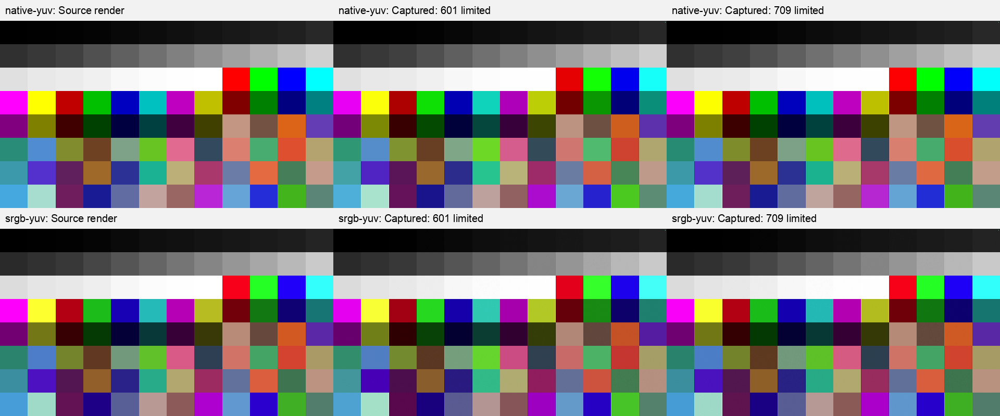
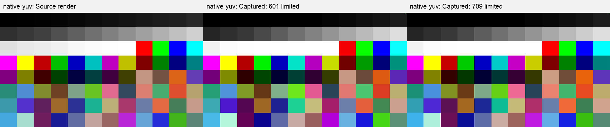
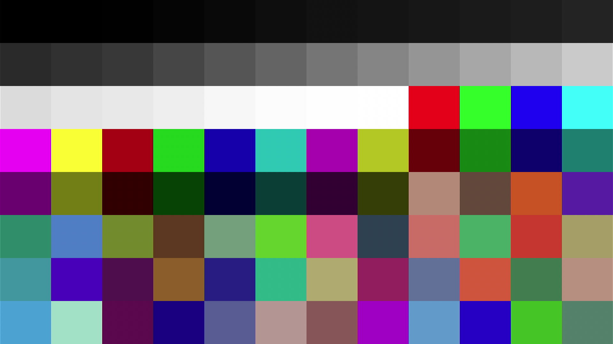
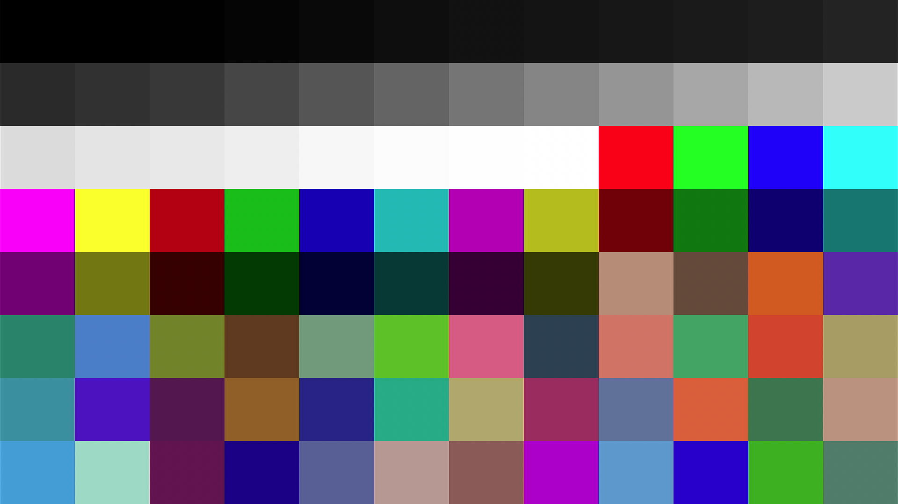
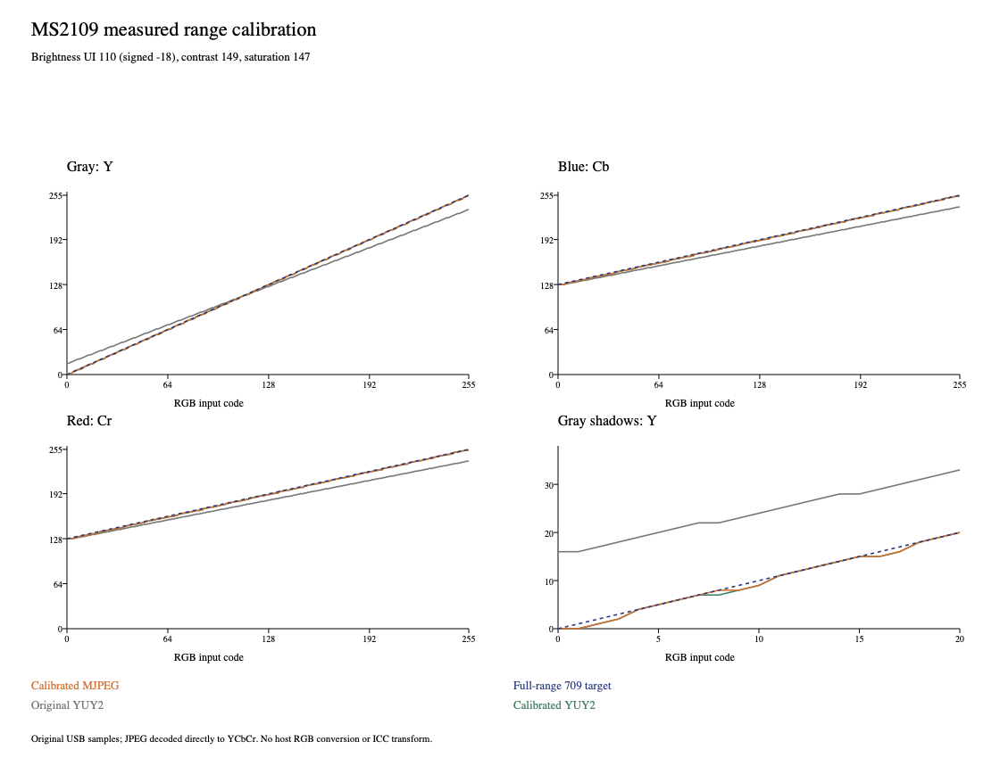

# MS2109-Pro firmware

A reproducible 2 KiB EEPROM image for the MS2109 capture device. This release keeps the stock UVC control handlers and `usb video` USB header names. The project name “MS2109-Pro” is not a claim about the device’s advertised USB name.

## Build

Requires Python 3.10 or later; no third-party packages are used.

```sh
python3 builder/build_release.py /tmp/ms2109-pro-rebuilt.bin
shasum -a 256 /tmp/ms2109-pro-rebuilt.bin
cmp firmware/ms2109-pro.bin /tmp/ms2109-pro-rebuilt.bin
python3 -m unittest discover -s builder -p 'test_*.py'
```

The builder refuses to overwrite its output or manifest. It validates the pinned base EEPROM and mask ROM, enforces the EEPROM code limit, and checks the final SHA-256.

| Input/output | SHA-256 |
|---|---|
| Original EEPROM | `37103dccfc6c5e2062b6d22a0a619729449427270e52ae4332fde0da0f49dfe1` |
| Mask ROM | `b383ef31fca43ebc58a22be8e342d9a1e33ec1cc15afce02921910b0ca358bc8` |
| MS2109-Pro EEPROM | `0d8d3139b51edc4ff283dab33f00c2270f2134d95bce4bf7a351dcf38c14bb82` |

## Firmware changes

- **1080p MJPEG rates:** The descriptor advertises 30, 25, 20 and 10 fps. The default is 30 fps. Two identical 30 fps interval entries are retained because the descriptor table has a fixed-size slot for the removed 60 fps entry. Other formats and resolutions are outside this cap.
- **Startup procamp:** Brightness UI 110 (signed UVC −18), contrast 149, saturation 148 and hue 0 are loaded at startup. The original UVC GET/SET request handling remains in mask ROM.
- **Colour declaration:** The high-speed YUY2/MJPEG UVC descriptors report the measured BT.709 matrix instead of the previous BT.601 declaration. This changes metadata; it does not put a quantization-range flag in the stream. UVC has no such range field here.
- **Stereo routing:** The firmware sets the USB audio stream to two channels and routes the tested HDMI source’s continuous left channel to USB left and its gapped right channel to USB right. This does not correct the measured one-sample audio offset.

The original firmware did not advertise a UVC Sharpness control. This release preserves the original control descriptor and request handling; it does not add a Sharpness control.

## Input, samples and colour range

RGB is converted by the source and HDMI path before the capture device produces YUY2 or MJPEG. YUY2 carries sampled Y′CbCr values directly. MJPEG carries quantized JPEG Y′CbCr samples; a host decoder then converts those samples to YUV or RGB using its own matrix and range assumptions. The firmware’s BT.709 descriptor helps only software that reads and applies it. JPEG data from this device does not reliably signal a BT.709 matrix or full-range setting to generic decoders.

The calibration used 96 RGB chart patches and captured the two USB transports. It did not inspect HDMI wire codes, test every RGB/YUV input negotiation, or cover all RGB triplets. HDMI input encoding choices were operator-selected, not independently read from the link. The figures below are earlier calibration runs, not fresh visual qualification of the installed release. See the archived [calibration report](https://github.com/matiaspl/MS2109-Pro/blob/experiments/development/artifacts/color-probe/20261006-auto-calibration-v2/report.md), [startup range comparison](https://github.com/matiaspl/MS2109-Pro/blob/experiments/development/artifacts/color-probe/20261006-calibrated-startup-yuy2/report.md), and [cold-start mode readback](https://github.com/matiaspl/MS2109-Pro/blob/experiments/development/artifacts/uvc-mode-cap-20261009/installed-after-cold-restart-retry.json).

### Limited and full-range settings

| Use | Brightness / contrast / saturation / hue | Measured range and notes |
|---|---|---|
| Neutral limited-range baseline | 128 / 128 / 128 / 0 | Gray Y 16–235; measured chroma was about 16–239. Use with a matching limited-range consumer. |
| Measured full-range target | 110 / 149 / 147 / 0 | Gray Y 0–255 and Cb/Cr 1–254 in both captured transports. Brightness 110 is signed UVC −18. Best measured balance in the local search, not a verified global optimum. |
| Release startup values | 110 / 149 / 148 / 0 | Values in this EEPROM image. Saturation 147–149 produced the same measured chroma endpoints; 147 had slightly lower numerical error. |

At the measured full-range settings, patch-median Y/Cb/Cr RMSE against the full-range BT.709 target was **0.565 / 1.036 / 1.055 codes for YUY2** and **0.533 / 1.026 / 1.043 codes for MJPEG**. The limited baseline was closest to BT.709 limited among tested matrix/range models (0.860 YUV-code RMS). These are numeric patch results, not guarantees for every input signal or host display path.

Full-range expansion does not restore precision lost to quantization. The run measured 234 distinct YUY2 gray patch medians and 220 distinct MJPEG gray patch values; MJPEG also had 36 unchanged adjacent gray-input pairs. MJPEG compression and the host decoder remain part of the output result.

### YUY2 calibration comparison

The first panel shows the neutral control baseline; the second shows the calibrated full-range setting. Each compares the RGB source render with captured YUY2 interpreted as BT.601 limited or BT.709 limited. These are calibration captures, not a before/after firmware flash comparison.





### MJPEG decoder comparison

Both panels decode the same calibrated MJPEG samples, with the color interpretation changed. The default decoder interpretation shifts the colour result; the second applies BT.709 full range. This shows the host-decoding step, not a new device-side conversion.





### Measured range curves

The plot compares calibrated YUY2 and MJPEG patch medians with the full-range BT.709 target and the earlier YUY2 baseline. MJPEG tracks the target closely but resolves fewer adjacent gray inputs.



## Qualification and limitations

The EEPROM readback matched the release hash after a cold restart. The 1080p MJPEG descriptor then reported intervals 333333, 333333, 400000, 500000 and 1000000 in 100 ns units (approximately 30, 30, 25, 20 and 10 fps), with the default at 30 fps. The host denied the direct UVC capture attempt, so this release’s post-restart frame payload and PTS were not verified. The calibration measurements cited above were captured in earlier sessions.

The colour results cover a local control search and 96 patches; they are not exhaustive. RGB and YUV HDMI input modes were not independently confirmed at the wire. Consumer-side matrix/range conversion must be checked separately. Stereo routing was tested with the described HDMI source; other sources may differ.
