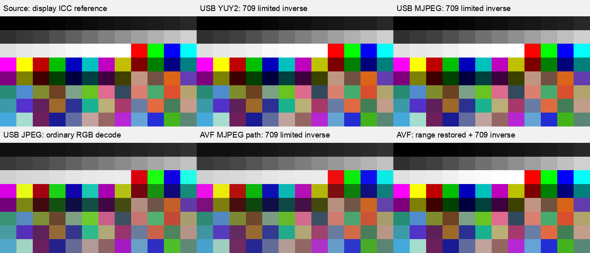

# MS2109 uncompressed and original MJPEG color probe

The original USB YUY2 and MJPEG frames both contain **BT.709 limited-range YCbCr** for the Mac's current 1920×1080 HDMI output. Their measured patch samples differ by only **0.083 YUV code values RMS**. The host-decoded MJPEG path applies a second full-to-limited conversion, while a normal JPEG RGB decode interprets the samples as 601/full. These are two distinct sources of incorrect color/levels.

The user confirms that **both True Tone and Night Shift were enabled before** the message "disabled night shift and true tone", and **both were disabled afterward**. The clean repeats and original USB captures in this report took place afterward. All captures ran outside the macOS shell sandbox. The external **HDMI TO USB** display remained extended, at 1920×1080, scale 1, with its existing ICC profile. The built-in display remained the main display.

## Original payload measurements

Eight consecutive frames per USB format were saved directly by libuvc after three seconds of chart settling. YUY2 was negotiated at 5 fps; MJPEG at 30.00003 fps. JPEG files are 86,497 or 86,637 bytes; YUY2 files are exactly 4,147,200 bytes. JPEG SOI/EOI, 1920×1080 dimensions, decoder warnings, and expected buffer lengths were checked. Recorded sequences are consecutive and central patch medians do not vary across the eight frames.

| Saved path | Black Y/Cb/Cr | White Y/Cb/Cr | 709 limited YUV RMSE | 601 limited YUV RMSE |
|---|---|---|---:|---:|
| Original USB YUY2 | 16 / 128 / 128 | 235 / 128 / 128 | **0.759** | 5.585 |
| Original USB MJPEG, decoded to YCbCr | 16 / 128 / 128 | 235 / 128 / 128 | **0.748** | 5.588 |
| AVFoundation MJPEG path, delivered packed YUV | 30 / 128 / 128 | 218 / 128 / 128 | 6.307 before undoing extra scaling | — |
| Same AVFoundation samples, extra scaling reversed | ≈16 / 128 / 128 | ≈235 / 128 / 128 | **0.781** | 5.600 |

RMSE is across the Y, Cb and Cr values of all 96 patch interiors. The RGB reference is the saved AppKit render in the active display ICC space. Full-range models fit substantially worse; original MJPEG 709/full has 7.292 YUV codes RMS error. BT.2020 limited has 2.386 and does not explain the data as well as 709. No arbitrary 3×3 fitted transform is used to rank these standards.

The JPEG decoder requests `JCS_YCbCr` from libjpeg-turbo with integer IDCT. It performs decompression and chroma upsampling, without YCbCr-to-RGB or range conversion. All eight JPEGs decode without warnings. They use 4:2:2 sampling (Y 2×1; Cb/Cr 1×1), with no JFIF, Adobe or ICC marker detected by the helper. Original compressed payloads remain unchanged.

[Original USB payloads](../artifacts/color-probe/20261006-original-usb/) · [source/display metadata](../artifacts/color-probe/20261006-original-usb-source/display-ready.json) · [numeric analysis](../artifacts/color-probe/20261006-original-usb-analysis/analysis.json) · [96 paired patches](../artifacts/color-probe/20261006-original-usb-analysis/patches.csv)

## Extra range conversion in the host MJPEG path

Compared with the original JPEG YCbCr samples, the AVFoundation delivered buffer follows:

```text
Y_avf  = 16  + (219 / 255) × Y_jpeg
Cb_avf = 128 + (224 / 255) × (Cb_jpeg − 128)
Cr_avf = 128 + (224 / 255) × (Cr_jpeg − 128)
```

The prediction error is **0.256 YUV codes RMS**, versus **6.107** if the samples are assumed unchanged. This localizes the additional scaling to the host path after USB JPEG acquisition. It does not identify which private macOS decoder/driver component applies it.

The JPEG already contains video limited-range values. Treating them as full-range values and packing them into a limited-range video buffer therefore raises black to 30 and lowers white to 218. The chroma excursion is reduced again too. Simply interpreting that buffer with a 709 limited inverse gives **11.383 RGB codes RMS error**. Reversing the extra scaling first, then applying the 709 limited inverse, reduces this to **1.681**, comparable to original YUY2's **1.686** and original MJPEG's **1.658**.

The saved AVFoundation test selects active `420v` at approximately 30 fps and requests packed output; its delivered frames are `2vuy` (UYVY). This is host-decoded evidence. The independent libuvc recording above preserves the actual compressed USB frames.

## Matrix declaration and ordinary JPEG decoding

The currently enumerated UVC color descriptors declare primaries **1**, transfer **1**, matrix **4** for both format 1 (MJPEG) and format 2 (YUY2). That is 709 primaries/transfer with a SMPTE 170M / 601 matrix declaration. The measured 1080p samples match a 709 matrix instead. [Live descriptor read](../artifacts/color-probe/20261006-live-uvc-color-descriptors.json)

The native AVFoundation path supplies a 709 matrix attachment, but the host-decoded path attaches a Composite NTSC color space. Declarations differ across layers; they cannot replace measurement of the samples. [Native metadata](../artifacts/color-probe/20261006-neutral-yuy2/native-yuv/capture.json) · [decoded metadata](../artifacts/color-probe/20261006-neutral-decoded/native-avf420v/capture.json)

Opening an original JPEG through Pillow's ordinary RGB decoder yields **13.141 RGB codes RMS error** against the source. Its result matches a clipped **601/full** numeric inverse within **0.241 RGB codes RMS**. In this tested path, both the matrix assumption and range assumption disagree with the captured samples. This does not prove every application uses that exact transform.

For this 1080p input, a consumer of original USB YUY2 or JPEG YCbCr should explicitly use **709 limited**. A consumer of the tested AVFoundation MJPEG packed buffer needs to undo the additional range compression before that inverse. This correction was applied only to saved diagnostic previews. Changing the UVC matrix declaration alone would address metadata but would not necessarily fix the JPEG range handling; no firmware patch or live application filter was installed.

The 601 and 709 equations and their limited-range conventions are documented in the [Linux V4L2 color descriptions](https://docs.kernel.org/userspace-api/media/v4l/colorspaces-details.html). UVC color enums are in the [Linux USB video header](https://github.com/torvalds/linux/blob/master/include/uapi/linux/usb/video.h).

## Visual comparison

Top row: source reference, original YUY2 with 709 limited inverse, original MJPEG with the same inverse. Bottom row: ordinary JPEG RGB decode, host MJPEG buffer with an uncorrected 709 limited inverse, and the host buffer after undoing extra range scaling.



[Gray-ramp plot](../artifacts/color-probe/20261006-original-usb-analysis/gray-ramp.svg) preserves the original black/white levels and the compressed host ramp. The previews use explicit numerical transforms; they do not apply the host's Composite NTSC attachment.

## Color-state correction and restoration checks

The user-provided timeline establishes the display adjustment state: **both enabled during the earlier baseline, both disabled for the later clean repeat**. The probe originally mislabeled `AutoBlueReductionEnabled` as Night Shift's active state, then incorrectly treated the private API's `BlueReductionEnabled=0` as proof that Night Shift was off during the baseline. The runtime check establishes a dictionary field mapping, not visual effect activity. That zero reading conflicts with the user's known enabled state, so the helper now labels it as an API-reported flag and marks visual effect state unverified. Configured 4100 K and strength 0.5 are retained as settings, not activity evidence. Raw bytes remain available; prior metadata is retained beside annotated captures. [Private API dictionary observation](../artifacts/color-probe/bluelight-status-validation.txt) · [user timeline](../artifacts/color-probe/user-color-state-timeline.json)

Both adjustments were enabled in the earlier yellow-cast baseline and disabled for the clean repeat, which restores neutral white to Cb/Cr 128/128. The comparison supports a white-point effect from the enabled adjustments together; it does not isolate how much True Tone or Night Shift contributed individually. The probes did not independently measure the HDMI wire or each display adjustment stage. The raw USB matrix/range and extra host range-conversion findings come from captures after both were disabled and remain unchanged.

The user explicitly authorized a one-time administrator authentication prompt to capture original frames. libuvc temporarily claimed the grabber's UVC interface and released it when each capture finished. The chart presenter closed, the device remained enumerated as `usb video`, and a subsequent **real AVFoundation acquisition saved three valid 1920×1080 YUY2 frames**, again matching 709 limited within 0.759 YUV codes RMS. [Post-capture inventory](../artifacts/color-probe/20261006-driver-restored-inventory.json) · [restored stream analysis](../artifacts/color-probe/20261006-driver-restored-yuy2/analysis.json)

Picture controls still read `c6a0=0000800000008000`, `fe90=00808000`: brightness 0, contrast 128, saturation 128, hue 0. They match the preceding clean captures. No firmware, EEPROM, picture controls, global display profile, mode, True Tone or Night Shift setting was written by the probe. [Post-capture HID read](../artifacts/color-probe/20261006-original-usb-procamp-after.json)

## Reproduction

Normal capture and paired analysis:

```sh
python3 tools/probe_colors.py run --output artifacts/color-probe/new-yuy2 --spaces native srgb --transport yuv
python3 tools/probe_colors.py run --output artifacts/color-probe/new-decoded --spaces native srgb --transport avf420v
python3 tools/probe_colors.py compare artifacts/color-probe/new-yuy2/native-yuv artifacts/color-probe/new-decoded/native-avf420v --output artifacts/color-probe/new-comparison.json
```

Original USB capture additionally requires the installed libuvc/libusb and libjpeg-turbo libraries. Build the three helpers in a private temporary directory, then invoke the administrator wrapper with absolute paths. It prompts once, displays the chart only after authentication, and acquires MJPEG followed by YUY2. No password is passed on a command line.

```sh
probe_tmp=$(mktemp -d /tmp/ms2109-probe.XXXXXX)
clang -I/opt/homebrew/include -L/opt/homebrew/lib tools/capture_video_uvc.c -luvc -lusb-1.0 -lpthread -o "$probe_tmp/capture"
clang -fobjc-arc -Wno-deprecated-declarations tools/color_probe_macos.m -framework Cocoa -framework AVFoundation -framework CoreMedia -framework CoreVideo -framework CoreGraphics -framework ImageIO -framework UniformTypeIdentifiers -framework ScreenCaptureKit -o "$probe_tmp/presenter"
clang -fobjc-arc -Wno-deprecated-declarations tools/run_capture_video_uvc_admin.m -framework Foundation -framework AppKit -framework Security -o "$probe_tmp/admin-wrapper"
"$probe_tmp/admin-wrapper" "$probe_tmp/capture" "$probe_tmp/presenter" "$PWD/artifacts/color-probe/pattern.json" "$PWD/artifacts/color-probe/new-usb" both
python3 tools/analyze_usb_colors.py artifacts/color-probe/new-usb artifacts/color-probe/new-usb-source artifacts/color-probe/new-decoded/native-avf420v --output artifacts/color-probe/new-usb-analysis
```

All acquisition commands require access outside the macOS shell sandbox. Analysis is file-only and can run inside it. The original USB frame metadata, source render/profile, intermediate first-frame YCbCr, all decoder metadata, previews and SHA256 manifest are saved separately.

## Remaining boundaries

This confirms the matrix/range behavior for the current Mac source at 1080p with neutral picture controls. It does not establish behavior for SD input, another HDMI source, HDR, other firmware, or non-neutral controls. The reference precedes late compositor/HDMI processing because Screen Recording permission was unavailable. The probe does not independently establish HDMI wire RGB/YCbCr format or range, the physical color accuracy of the display profile, or the hardware register that selects a matrix.
