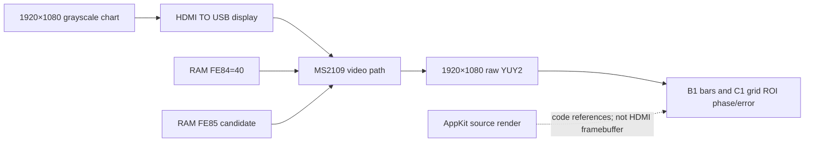

# MS2109 FE85 native 1080p characterization report

> Analysis date: 2026-10-07  
> Target: connected MS2109 USB capture unit  
> Test: native 1920×1080 HDMI input to 1920×1080 YUY2 capture, FE84 fixed at `0x40`

## Executive summary

For native 1080p-in to 1080p-out, use **FE85=`0x00` as the best reference candidate** with FE84=`0x40`. This is the boot-aligned value, and it gives an exact pixelwise match in the 2-pixel vertical-bar ROI while preserving the 1-pixel-grid phase. It is not a unique optimum: FE85=`0x01` ties on those ROIs, and other bit-1-clear values preserve phase with small differences. FE85=`0x20` has a whole-frame direct-code MAE lower by only 0.016 Y code, but its 2-pixel bar ROI is slightly less exact.

The strongest result is bit-level: every tested FE85 value with bit 1 set moved the 2-pixel bars and 1-pixel grid by one horizontal pixel; all tested values with bit 1 clear preserved their phase. That agrees with ROM initialization clearing FE85 bit 1 and the related-family name `vin_hscale_hi`. It does not decode the remaining FE85 bits or establish the scaler's internal arithmetic.

The new capture supports the user's range-level hypothesis for the earlier code-value mismatch. This session fits direct AppKit gray codes (outside the small capture overlay, MAE 0.331; 100% of samples within one code); the earlier saved session fit a full-to-limited Y conversion. The source-render pixel arrays are identical, but their embedded display profiles differ. The AppKit render is not a captured HDMI framebuffer, so the evidence does not establish which display, link, or capture stage applies a range conversion.

All writes were temporary RAM writes. The probe restored FE84=`7A`, FE85=`00`, the other monitored registers, procamp controls, and UVC shadows; the EEPROM SHA-256 stayed `83d13d9f31aee5301937adffbe8ed86c56ea5ec95a9880c4260cb7d25e1d5e82`. No EEPROM or firmware write occurred.

## Scope and setup

The user requested a native-mode FE85 sweep with FE84 held at `0x40`. Scope and authorization are recorded in the [project scope](scope.md). The device displayed the 1920×1080 grayscale chart on `HDMI TO USB`; AVFoundation captured raw 1920×1080 YUY2 at five frames per value. The probe tested every FE85 byte from `0x00` through `0x20`, then `0x40`, `0x80`, and `0xFF`. Controls were held at neutral `00809300` with matching UVC shadows `0000800000009300` during the sweep.

The analyzer scored both direct AppKit gray-code and full-to-limited Y references, then compared phase-sensitive B1 2-pixel bars and C1 1-pixel grids at integer offsets from −2 to +2 pixels. Each ROI is text-free. Captured Y samples were read directly from YUY2; no RGB decode was used for the measurement.

## Findings

### F-001 — FE85 bit 1 toggles a one-pixel horizontal phase

- Severity: n/a (register characterization)
- Status: observed
- Confidence: high for this native mode and chart
- Evidence: E-001, E-002, E-003, E-005
- Location: XDATA `FE85`, with FE84=`40`

All 17 tested values with bit 1 set (`02, 03, 06, 07, 0A, 0B, 0E, 0F, 12, 13, 16, 17, 1A, 1B, 1E, 1F, FF`) produce a one-pixel phase reversal in both ROIs. At FE85=`02`, B1's unshifted MAE is 103.780 Y codes and becomes 0 at either adjacent one-pixel reference shift; C1's unshifted MAE is 215.5 and becomes 0.5 after the shift. All 19 tested values with bit 1 clear preserve phase. The ROM clears this bit during video setup; MS2107 source names FE85 `vin_hscale_hi` and applies the same bit mask. The remaining bits are not decoded.

### F-002 — FE85=`00` is the preferred boot-aligned native reference candidate

- Severity: n/a (register characterization)
- Status: candidate
- Confidence: medium
- Evidence: E-001, E-002, E-003
- Location: XDATA `FE85`; related FE84/FE85 table in [register reference](ms2109-reference/registers.md)

At FE85=`00`, the B1 2-pixel-bar ROI has zero pixelwise error against the direct AppKit render, and C1's 1-pixel grid has 0.5-code MAE. FE85=`01` ties those ROI scores. Values through `0x0D` with bit 1 clear also preserve the measured phase. FE85=`00` is selected as the practical reference because it matches the live post-boot value and the ROM-cleared state, not because the experiment proves it is uniquely optimal for every source or capture mode.

FE85=`20` has the lowest tested full-frame direct-code MAE (0.314588 versus 0.331019 at `00`, a 0.016431-code difference), but its B1 bar ROI MAE is 0.451220 instead of 0.000000. That tiny whole-frame gain does not outweigh the exact high-frequency bar match for a pixel-alignment reference. FE85=`40` and `80` preserve phase but progressively raise the B1/C1 errors to 0.902/1.0 and 2.256/2.5 respectively. This is a mode-specific reference choice, not a recommendation to burn a persistent value.

### F-003 — The fresh capture fits direct code values; the prior run fit limited-range Y

- Severity: n/a (measurement interpretation)
- Status: observed
- Confidence: high for the saved captures; conversion stage unresolved
- Evidence: E-003, E-004
- Location: captured Y plane and source-render reference

At FE85=`00`, outside the top-right 20×20 capture overlay, direct AppKit gray codes give MAE 0.331019, 100% within one Y code, and maximum absolute error 1. The full-to-limited model `Y = 16 + floor(219 × RGB/255)` gives MAE 9.927639 and 36.034% within one code. The flat-field source codes 17/117/232 measure as 16/117/232 in captured Y, with zero variation inside the sampled regions.

The earlier native FE84=`40` session fit the limited-range model to within one code outside the overlay, while the new session fits direct codes. Both source-render PNGs contain identical grayscale pixels, but their embedded 524-byte ICC profile hashes differ: `3147e8fdecf138c0b8063fcb3656d58ec0ed33f499079b7f0a9c774c6f1c2b6a` in the earlier session and `4d23d97660bf0e9ad3014db833cc6ddb34458af06a7aea5bb6d1eee370a004a2` in the new session. This supports the view that level interpretation or session path explains the previous code-value difference. It does not prove the HDMI link's quantization range or identify where any conversion occurs; neither AppKit PNG is an HDMI framebuffer capture.

### F-004 — Temporary state was restored and persistent storage was unchanged

- Severity: n/a
- Status: observed
- Confidence: high
- Evidence: E-001, E-002
- Location: live RAM and attached EEPROM

Both completed probes record restoration to FE80=`01`, FE84=`7A`, FE85=`00`, F9A0=`00`, F92C=`20`, FEBA=`00`, controls `ee959300`, and UVC shadows `eeff950000009300`. The before/after EEPROM image hash is identical, and both probe records state `firmware_written=false`.

## Evidence

| ID | Source and observation | Content hash | Reproduction |
|---|---|---|---|
| E-001 | Fine sweep, 33 FE85 values (`00`–`20`), five raw YUY2 frames per value: [result and captures](../artifacts/scaler-f9a0/native-fe85-1080-fine-20261007/) | Result JSON SHA-256 `19f91569d147dc11cbcb9efee5a4640309098c87735a42fbf1008d8e3285f937` | `python3 tools/probe_native_fe85.py --chart-session artifacts/scaler-f9a0/chart-session-fe85-native-20261007b --output /private/tmp/ms2109-fe85-fine --values 00 01 02 03 04 05 06 07 08 09 0a 0b 0c 0d 0e 0f 10 11 12 13 14 15 16 17 18 19 1a 1b 1c 1d 1e 1f 20` |
| E-002 | Broad sweep at `40, 80, FF`, same capture format and frame count: [result and captures](../artifacts/scaler-f9a0/native-fe85-1080-sweep-20261007/) | Result JSON SHA-256 `b9e36529d5dba9c3feb9e62d3242b938022dd0e78263954285da5ad71a7af2ec` | `python3 tools/probe_native_fe85.py --chart-session artifacts/scaler-f9a0/chart-session-fe85-native-20261007b --output /private/tmp/ms2109-fe85-broad --values 40 80 ff` |
| E-003 | Combined phase, ROI, range-model analysis and separate SVG plots: [JSON](../artifacts/scaler-f9a0/native-fe85-1080-analysis-20261007/native-fe85-1080-analysis.json), [dashboard](../artifacts/scaler-f9a0/native-fe85-1080-analysis-20261007/native-fe85-1080-dashboard.html) | JSON SHA-256 `251419ade310c90b3f67168c397d4132c50b262b4053d63de4eae706ed24bbae`; dashboard SHA-256 `9f2c24af09dcbd7e63e0fee32466a7955e2e7c86edb478f7c74a9cdec5dc922c` | `python3 tools/analyze_native_fe85.py --output-dir artifacts/scaler-f9a0/native-fe85-analysis-rerun` |
| E-004 | Earlier native FE84 sweep and source render used for the limited-range comparison: [analysis JSON](../artifacts/scaler-f9a0/native-1080-roi-final-20261007/native-1080-roi.json), [source render](../artifacts/scaler-f9a0/chart-session-20261007-001220-51789/source-render.png) | JSON SHA-256 `cb857442c061ec44c80350001203411838bd85fd0935a01c4d85cc14977f69e5`; source render SHA-256 `46006d710cab7c1dd7b941a12bb2e1db9e73b48c64486956b7dcbcc8757ecc1b` | `python3 tools/analyze_native_1080_roi.py --output-dir artifacts/scaler-f9a0/native-1080-roi-rerun-20261007` |
| E-005 | Static initialization and cross-family evidence for FE85 bit 1: MS2109 ROM snapshot and related MS2107 source | ROM SHA-256 `b383ef31fca43ebc58a22be8e342d9a1e33ec1cc15afce02921910b0ca358bc8`; MS2107 source SHA-256 `0dad9a0a013f5e9c28e361c5bc6f495bc6dd6b32ab4b0fe96482af37f11ad4cc` | Inspect FE85 setup in [scaler reference](ms2109-reference/scaler-and-sharpness.md) and search `vin_hscale_hi` in `upstream/macrosilicon_firmware/ms2107/eeprom/eeprom_fw.c` |

The dashboard also provides separate [direct-level](../artifacts/scaler-f9a0/native-fe85-1080-analysis-20261007/fe85-level-direct.svg), [limited-level](../artifacts/scaler-f9a0/native-fe85-1080-analysis-20261007/fe85-level-limited.svg), [B1 bars](../artifacts/scaler-f9a0/native-fe85-1080-analysis-20261007/fe85-b1-bars.svg), and [C1 grid](../artifacts/scaler-f9a0/native-fe85-1080-analysis-20261007/fe85-c1-grid.svg) plots so the level fits and ROIs remain visually distinct.

## Path

### P-001 — Chart-gated native FE85 RAM characterization

- Path type: callflow / measurement
- Start: connected device with verified chart, capture mode, RAM state and EEPROM hash
- Goal: select an FE85 reference candidate for FE84=`40` in native 1080p
- Steps:
  1. Verify the 1920×1080 chart on `HDMI TO USB`; record initial registers, UVC/procamp state, and EEPROM hash — E-001, E-002.
  2. Set neutral controls and FE84=`40`; write one FE85 candidate through HID B6, read it back, and capture five raw YUY2 frames — E-001, E-002.
  3. Compare B1/C1 ROIs at horizontal shifts −2…+2 and calculate direct and limited-level luma errors — E-003; findings F-001–F-003.
  4. Restore every touched RAM value and compare the EEPROM hash — E-001, E-002; finding F-004.
- Residual risks: source is an AppKit render rather than a captured HDMI raster; the sweep does not decode the complete FE85 word, characterize every source mode, or prove the internal scaler architecture.

## Timeline summary

- 2026-10-07: captured the coarse FE85 set at 1080p input/output with FE84=`40`; verified the test chart and restored state.
- 2026-10-07: captured every FE85 value from `00` through `20`, then combined both sweeps for pixel-phase and range-model analysis.
- 2026-10-07: compared the new direct-code fit with the earlier limited-range fit, recorded profile hashes, updated the register reference and saved independent plots.

## Reproduction limits

The live probe requires the connected device, the expected EEPROM baseline, the chart displayed on `HDMI TO USB`, and exclusive AVFoundation capture access. It performs RAM writes before restoring them. The analyzer and SVG/dashboard generation are offline and read saved raw captures. For a definitive level-range conclusion, capture a known test raster with a hardware HDMI pattern source or measure the HDMI framebuffer directly, then record the active RGB/Y quantization metadata along with the capture.
