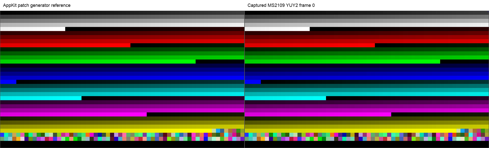
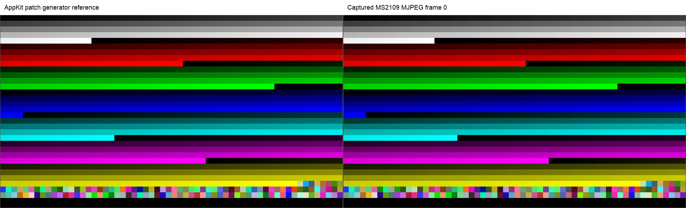

# MS2109 FE8E/FE8F procamp bypass findings

Date: 2026-10-08. Report type: register characterization (`flavor = null`).

## Summary and scope

The best current interpretation is that FE8E contains bypass flags for luma
adjustments and FE8F contains bypass flags for chroma adjustments. FE8E bit 0
suppresses the measured brightness response; bit 4 suppresses the measured
contrast response. FE8F bit 0 is consistent with saturation bypass. FE8F bit 4
remains unresolved; hue bypass is a hypothesis, not a demonstrated mapping.

This records previously authorized RAM experiments on the attached MS2109.
No new device operations were performed to prepare this report. Measurements
are specific to the captured patterns and modes. They do not establish a
complete register map, a CSC matrix selection, or improved color coverage.

## Findings

| Field | Proposed purpose | Supporting observation | Confidence in interpretation |
|---|---|---|---|
| FE8E.0 | Bypass brightness offset when set | Installed brightness was -18; setting this bit raised Y by 18 below clipping. With neutral brightness changed to +32, the response was +32 at FE8E=00/10 and zero at 01/11. | High for the tested path |
| FE8E.4 | Bypass contrast gain when set | Installed contrast was 149; measured slope ratio was about 0.858, matching 128/149 = 0.859. At FE8E=10, changing UVC contrast 128 to 160 left every sampled patch median unchanged in the clean repeat. | High for the tested path |
| FE8F.0 | Bypass saturation gain when set | Installed saturation was 147; chroma gain fell to about 0.870, matching 128/147 = 0.871, without measurable hue rotation or gray/luma change. Neutral-procamp bars showed no effect. | Strong hypothesis; a direct nonneutral saturation interaction sweep remains useful |
| FE8F.4 | Possibly bypass hue rotation | Hue was zero in the calibrated baseline; only a small chroma gain (about 1.008, or about 1.005 on SMPTE bars) was observed. | Tentative; requires nonzero-hue comparison |

These are per-stage effects: hue and saturation still responded at all tested
FE8E states. UVC SET/GET can succeed while a downstream adjustment has no
measurable image effect.

### F-001: Brightness and contrast response suppression

- Status: validated measured behavior; register names remain interpretations.
- Category: reverse_algo; severity: n/a_re; location: FE8E bits 0 and 4.
- Evidence: E-001, E-002, E-003.
- Impact: brightness and contrast controls can retain readable/writable values while their image response is suppressed.
- Confidence: high within the tested native 1080p Mac chart capture path.
- Reproduction: inspect the interaction table and the repeat patch medians below.
- Remediation: n/a for characterization; do not equate SET/GET success with image response.

### F-002: Chroma-stage bypass candidates

- Status: candidate; category: reverse_algo; severity: n/a_re.
- Location: FE8F bits 0 and 4; evidence: E-001, E-004.
- Impact: the calibrated bit-0 gain matches removing the installed saturation gain. Bit 4 has a small chroma-only effect whose semantic purpose is unresolved.
- Confidence: medium for saturation bypass; low for hue bypass.
- Reproduction: compare calibrated bit fits and neutral-procamp SMPTE analyses.
- Remediation: test nonzero hue with FE8F.4 clear/set before assigning a hue label.

## Clean FE8E=10 contrast repeat

The first FE8E=10 / contrast-160 acquisition captured desktop content instead
of the full chart. That condition is excluded. The targeted repeat explicitly
raised the chart window and checked the actual captured patch grid.

UVC contrast 160 read back as 160 while FE8E=10 was active. All 1,920 sampled
patches (5,760 Y/Cb/Cr medians) exactly matched the earlier valid contrast-128
capture, independently in YUY2 and MJPEG. Gray-ramp slope was 0.8589258 in
both formats, with a ratio of 1.0000 to that neutral-control reference.

| Output | Held-out patch-fit RMSE, codes | Maximum temporal patch span, codes |
|---|---:|---:|
| YUY2 | 0.421 | 0.000 |
| MJPEG | 0.436 | 0.500 |

Reference left, captured output right:

The [YUY2 mixed-color detail](evidence/2026-10-08-fe8e-fe8f/patch-detail-yuy2.png)
and [MJPEG detail](evidence/2026-10-08-fe8e-fe8f/patch-detail-mjpeg.png) preserve
the small color patches at native horizontal resolution. Preview decoding is
limited-range BT.709; the earlier full-range preview was misleading.

## Evidence and preservation

| ID | Preserved evidence | What it supports |
|---|---|---|
| E-001 | [Calibrated bit report](evidence/2026-10-08-fe8e-fe8f/calibrated-bit-report.md), [analysis](evidence/2026-10-08-fe8e-fe8f/calibrated-bit-analysis.json) | Installed-procamp luma/chroma responses |
| E-002 | [FE8E interaction report](evidence/2026-10-08-fe8e-fe8f/procamp-interaction-report.md) | Brightness, contrast, hue and saturation interactions; original bad contrast condition explicitly invalid |
| E-003 | [Clean repeat state](evidence/2026-10-08-fe8e-fe8f/repeat-run-state.json), captured images above | Actual chart presence, contrast SET/GET, patch equality and stability |
| E-004 | [RGB](evidence/2026-10-08-fe8e-fe8f/smpte-rgb444-analysis.json), [YUV 4:2:2](evidence/2026-10-08-fe8e-fe8f/smpte-yuv422-analysis.json), [YUV 4:4:4](evidence/2026-10-08-fe8e-fe8f/smpte-yuv444-analysis.json) | Neutral-procamp 16-pair sweeps; HDMI encodings operator-selected, not independently read from link |
| E-005 | [Repeat restoration](evidence/2026-10-08-fe8e-fe8f/repeat-restoration.json), [interaction restoration](evidence/2026-10-08-fe8e-fe8f/procamp-interaction-restoration.json), three SMPTE restoration records in evidence directory | RAM/control restoration and unchanged EEPROM |

The [manifest](evidence/2026-10-08-fe8e-fe8f/manifest.json) records SHA-256 and
original acquisition paths for each preserved file. Evidence files are exact
copies; their embedded paths and report-relative references describe the
original artifact tree. Large raw streams and pending probe implementation
changes remain outside this focused findings commit. This package supports
inspection of saved measurements, not a complete raw-stream reanalysis.

No new live verification was performed for this commit. Previously recorded
restoration read back brightness -18, contrast 149, hue 0, saturation 147 and
FE8E/FE8F=00/00. The before/after EEPROM SHA-256 was
`2c8e7378b6d23c324726b0fc641f9170af92692b00cf272fe59fda43c9f2fdc5`;
the recorded experiments made zero EEPROM writes.

## Path and timeline

P-001 (callflow): installed procamp plus isolated RAM bits → calibrated patch
responses (E-001, F-001/F-002) → neutral controls plus individual UVC changes
at FE8E=00/01/10/11 (E-002, F-001) → exclude the desktop capture and repeat
FE8E=10 / contrast 160 in both USB formats (E-003, F-001) → restore and read
back RAM, controls and EEPROM hash (E-005). These experiments and the targeted
repeat were acquired on 2026-10-08.

Residual limits: the remaining FE8F hue hypothesis needs a nonzero-hue test;
other bits, timings and geometries are not fully decoded. Neutral-procamp
no-change results are compatible with bypassing a neutral adjustment and do
not by themselves prove that a register is unused.
