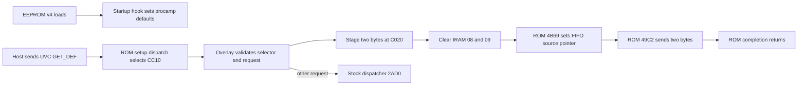

# MS2109 procamp defaults cold-boot validation

> Date: 8–9 October 2026
> Target: attached MS2109, USB ID `534d:2109`
> Status: v4 is installed and cold-boot verified. EEPROM and loaded RAM code match the candidate; startup RAM, USB names, and all four `GET_DEF` values passed.

## Summary

The v3 check observed the requested startup values, `GET_CUR`, names, and EEPROM hash, while `GET_DEF` returned zero bytes. It did not compare the loaded code in RAM with EEPROM. A later live inspection found the v1 overlay in RAM alongside the v3 header and EEPROM, so the earlier check did not establish that v3 code had actually run. Ghidra tracing and a live RAM-only v4 test isolated the EP0 transfer issue: the ROM FIFO sender uses direct IRAM bytes 08:09 as a source offset. Clearing both bytes before the two-byte response made all four live `GET_DEF` queries succeed. After full USB power removal, v4 passed the read-only cold-boot check, including exact EEPROM and loaded-overlay matches.

## Scope and authorization

The target is the attached MS2109 in [`scope.md`](scope.md). The user requested persistent startup defaults and authorized firmware replacement and validation. The v3 and v4 EEPROM writes used the guarded writer after exact-current-image matches and verified each changed byte plus complete readbacks. The cold-boot checks are read-only; the v4 live qualification changed RAM only and restored it.

Report type: firmware reverse engineering (`flavor = null`). The target mask ROM is a raw 8051 image, so PE/ELF import-table analysis does not apply; ROM call targets were inspected through Ghidra cross-references and disassembly.

## Evidence

### E-001 — Installed v1 cold-boot results

- title: v1 read-only startup and UVC qualification
- observed_at: 2026-10-08
- source_type: file
- source_ref: `artifacts/sharpness-firmware/20261008-procamp-defaults/cold-boot-qualification-v1.json`
- content_hash: `sha256:c64aba39beaf051148cf78a5939c0b69dcc60e8d0bdf78013c298fb807044c71`
- artifact_path: `artifacts/sharpness-firmware/20261008-procamp-defaults/cold-boot-qualification-v1.json`
- repro_command: `python3 tools/qualify_procamp_defaults_cold_boot.py --candidate artifacts/sharpness-firmware/20261008-procamp-defaults/ms2109-procamp-defaults-ms2109-pro-candidate.bin --expected-sha256 8fbbc47c8fc9064d3d781d5fa65e11d9bb62fa3f7a491f1f5be14531df54da9d --output artifacts/sharpness-firmware/20261008-procamp-defaults/cold-boot-rerun.json`
- raw_excerpt: EEPROM reads both matched the installed v1 image; startup RAM was `C6A0=eeff950000009400`, `FE90=ee959400`; all four `GET_CUR` values matched; all four `GET_DEF` return codes were 0 with empty data; USB strings 2 and 4 were `MS2109-Pro`.
- linked_workitem: n/a
- supersedes: none

### E-002 — Installed image readback

- title: full v1 EEPROM image readback
- observed_at: 2026-10-08
- source_type: file
- source_ref: `artifacts/sharpness-firmware/20261008-procamp-defaults/postinstall-eeprom-readback.bin`
- content_hash: `sha256:8fbbc47c8fc9064d3d781d5fa65e11d9bb62fa3f7a491f1f5be14531df54da9d`
- artifact_path: `artifacts/sharpness-firmware/20261008-procamp-defaults/postinstall-eeprom-readback.bin`
- repro_command: `python3 tools/ms2109_hid.py backup --output artifacts/sharpness-firmware/20261008-procamp-defaults/eeprom-reread.bin`
- raw_excerpt: `validate()` reports 1,929 code bytes; the readback is byte-identical to the v1 candidate.
- linked_workitem: n/a
- supersedes: none

### E-003 — Corrected v3 offline firmware checks

- title: compact firmware offline regression suite
- observed_at: 2026-10-08
- source_type: file
- source_ref: `artifacts/sharpness-firmware/20261008-procamp-defaults/v3-offline-tests.txt`
- content_hash: `sha256:1abb7082d2d6972dd35099781927444b885c81b435ab3afd42f0c2c52ca7d834`
- artifact_path: `artifacts/sharpness-firmware/20261008-procamp-defaults/v3-offline-tests.txt`
- repro_command: `python3 -m unittest tests.test_compact_sharpness.CompactSharpnessTests -v`
- raw_excerpt: `Ran 20 tests ... OK`, including new four-selector `GET_DEF` response checks and retained Sharpness rejection checks.
- candidate: `artifacts/sharpness-firmware/20261008-procamp-defaults/ms2109-procamp-defaults-v3-ms2109-pro-candidate.bin`
- candidate_sha256: `91f4d30b5a85a2cca368b84ec1f1437ee30af29bc002fca9073993513a71ba3f`
- linked_workitem: n/a
- supersedes: none

### E-004 — Installed v3 cold-boot results

- title: v3 EEPROM and UVC GET_DEF check
- observed_at: 2026-10-08
- source_type: file
- source_ref: `artifacts/sharpness-firmware/20261008-procamp-defaults/cold-boot-qualification-v3.json`
- content_hash: `sha256:81488d7ff0deeaf50563861ccb5f6dcb8e99964d08331220de562cd95f9e867b`
- artifact_path: `artifacts/sharpness-firmware/20261008-procamp-defaults/cold-boot-qualification-v3.json`
- repro_command: `python3 tools/qualify_procamp_defaults_cold_boot.py --candidate artifacts/sharpness-firmware/20261008-procamp-defaults/ms2109-procamp-defaults-v3-ms2109-pro-candidate.bin --expected-sha256 91f4d30b5a85a2cca368b84ec1f1437ee30af29bc002fca9073993513a71ba3f --output artifacts/sharpness-firmware/20261008-procamp-defaults/cold-boot-qualification-v3.json`
- raw_excerpt: EEPROM reads both matched v3 SHA-256 `91f4d30b5a85a2cca368b84ec1f1437ee30af29bc002fca9073993513a71ba3f`; startup RAM and all four `GET_CUR` values matched; names were `MS2109-Pro`; each `GET_DEF` returned code 0 and an empty payload; `writes_performed` was 0.
- installation_record: `artifacts/sharpness-firmware/20261008-procamp-defaults/v3-installation.json`
- installation_readback_sha256: `91f4d30b5a85a2cca368b84ec1f1437ee30af29bc002fca9073993513a71ba3f`
- limitation: this qualification did not compare the loaded RAM overlay with EEPROM. It verified startup values and descriptors, but did not prove that v3 code was executing.
- linked_workitem: n/a
- supersedes: none

### E-005 — Live RAM-only v4 GET_DEF qualification

- title: staged v4 default-query test with exact restoration
- observed_at: 2026-10-09
- source_type: file
- source_ref: `artifacts/sharpness-firmware/20261008-procamp-defaults/procamp-get-def-ram-v4.json`
- content_hash: `sha256:764a535c4259ab013f25e68ed461bb7a18f858f9175b32dc7865fba001e8024f`
- artifact_path: `artifacts/sharpness-firmware/20261008-procamp-defaults/procamp-get-def-ram-v4.json`
- repro_command: `python3 tools/qualify_procamp_get_def_ram.py --output artifacts/sharpness-firmware/20261008-procamp-defaults/procamp-get-def-ram-v4.json`
- raw_excerpt: with v4 staged temporarily in RAM, selectors 2, 3, 6, and 7 returned `eeff`, `9500`, `0000`, and `9400` (−18, 149, 0, 148). The v4 code readback matched; after the test, RAM header and full overlay span matched the saved pre-test bytes, and two EEPROM reads still matched v3.
- status: passed; EEPROM writes: 0.
- linked_workitem: n/a
- supersedes: none

### E-006 — Installed v4 EEPROM readback

- title: guarded v4 EEPROM write and full readback
- observed_at: 2026-10-09
- source_type: file
- source_ref: `artifacts/sharpness-firmware/20261008-procamp-defaults/postinstall-v4-eeprom-readback.bin`
- content_hash: `sha256:a42bfa5919cf164a2a1b4edb4152b156fe65db5c58e55da9d53ef1c0bb52a3eb`
- artifact_path: `artifacts/sharpness-firmware/20261008-procamp-defaults/postinstall-v4-eeprom-readback.bin`
- repro_command: `python3 tools/flash_eeprom.py --expected-current artifacts/sharpness-firmware/20261008-procamp-defaults/postinstall-v3-eeprom-readback.bin --image artifacts/sharpness-firmware/20261008-procamp-defaults/ms2109-procamp-defaults-v4-ms2109-pro-candidate.bin --apply --readback artifacts/sharpness-firmware/20261008-procamp-defaults/postinstall-v4-eeprom-readback.bin`
- raw_excerpt: 598 changed bytes were written; the complete readback matched the v4 candidate. A separate pair of live EEPROM reads also matched this digest.
- linked_workitem: n/a
- supersedes: none

### E-007 — Running RAM did not match the EEPROM revision

- title: read-only post-install firmware identity inspection
- observed_at: 2026-10-09
- source_type: live read-only device inspection
- source_ref: `artifacts/sharpness-firmware/20261008-procamp-defaults/v4-postinstall-live-state.json`
- content_hash: `sha256:f2998379349d244fc81ece3e0ee218db8452b8126c22a57ccdf5ce362ba499bb`
- artifact_path: `artifacts/sharpness-firmware/20261008-procamp-defaults/v4-postinstall-live-state.json`
- repro_command: n/a — this captured the transient state before the user's full power removal; repeat state inspection with the v4 cold-boot qualification command.
- raw_excerpt: after v4 installation, EEPROM read twice as v4, but the RAM header still declared 1,929 code bytes and matched v3; the 1,933-byte loaded overlay matched the saved v1 candidate exactly. This prompted a full power removal; E-008 later confirms v4 loaded.
- limitation: this shows which code was active at inspection time. It does not identify why an earlier reconnect failed to reload the EEPROM image.
- linked_workitem: n/a
- supersedes: none

### E-008 — V4 cold-boot qualification

- title: v4 read-only cold-boot qualification
- observed_at: 2026-10-09
- source_type: file
- source_ref: `artifacts/sharpness-firmware/20261008-procamp-defaults/cold-boot-qualification-v4.json`
- content_hash: `sha256:3119988c486b7ce959eef3ed3b8fd2d40f1db7408540099be4f727cae27ef8f5`
- artifact_path: `artifacts/sharpness-firmware/20261008-procamp-defaults/cold-boot-qualification-v4.json`
- repro_command: `python3 tools/qualify_procamp_defaults_cold_boot.py --candidate artifacts/sharpness-firmware/20261008-procamp-defaults/ms2109-procamp-defaults-v4-ms2109-pro-candidate.bin --expected-sha256 a42bfa5919cf164a2a1b4edb4152b156fe65db5c58e55da9d53ef1c0bb52a3eb --output artifacts/sharpness-firmware/20261008-procamp-defaults/cold-boot-qualification-v4.json`
- raw_excerpt: two EEPROM reads matched v4; the RAM header and loaded overlay matched the candidate; C6A0 and FE90 held the requested startup values; USB strings 2 and 4 were `MS2109-Pro`; `GET_DEF` returned −18 / 149 / 0 / 148 and `GET_CUR` matched those values for all four controls.
- status: passed; writes performed during qualification: 0.
- linked_workitem: n/a
- supersedes: none

### E-009 — Mask-ROM EP0 sender analysis

- title: Ghidra tracing of the mask-ROM UVC default sender
- observed_at: 2026-10-09
- source_type: file
- source_ref: `backups/ms2109-maskrom.bin`
- content_hash: `sha256:b383ef31fca43ebc58a22be8e342d9a1e33ec1cc15afce02921910b0ca358bc8`
- artifact_path: `backups/ms2109-maskrom.bin`
- repro_command: Import the raw image into Ghidra with language `8051:BE:16:default`, analyze it, and inspect ROM `0x49C2`, `0x4DB4`, `0x58C8`, and `0x58FC` with cross-references.
- raw_excerpt: The GET_DEF branch stages two bytes, sets `R7=2`, and calls `0x49C2`. That sender reads direct IRAM `08:09` as a source offset; the setup path that clears this offset is not taken by the custom CC10 hook.
- linked_workitem: n/a
- supersedes: none

## Findings

### F-001 — Startup defaults are applied on cold boot

- severity: n/a_re
- category: other
- status: validated
- evidence_ids: [E-001, E-002, E-008]
- location: overlay startup callback at `common_code()` in `tools/sharpness_firmware.py`; XDATA `C6A0–C6A7` and `FE90–FE93`
- impact: after cold boot, the installed firmware initializes brightness −18, contrast 149, hue 0, and saturation 148.
- confidence: high
- repro_steps: inspect the E-001 RAM and `GET_CUR` fields and verify the EEPROM digest against E-002.
- remediation: none for startup initialization.

### F-002 — Installed v1 does not return procamp `GET_DEF` data

- severity: n/a_re
- category: other
- status: validated
- evidence_ids: [E-001, E-005, E-007]
- location: v1 CC10 USB request handler, `tools/sharpness_firmware.py`
- impact: hosts querying `GET_DEF` receive no bytes for brightness, contrast, hue, or saturation.
- confidence: high
- repro_steps: issue class-interface IN request `0x87`, `wIndex=0x0200`, selector in the high byte of `wValue`, and length 2 for selectors 2, 3, 6, and 7.
- remediation: resolved by the installed v4 image; E-008 verifies the cold-booted firmware returns all requested defaults.

### F-003 — v3's live `GET_DEF` result lacks code-load attribution

- severity: n/a_re
- category: other
- status: validated
- evidence_ids: [E-003, E-004]
- location: v3 `GET_DEF` handler and the v3 cold-boot qualification
- impact: the v3 qualification recorded empty responses, but it did not verify that the v3 overlay was loaded into RAM. The later RAM inspection found the exact v1 overlay active, so the v3 code path cannot be blamed from E-004 alone.
- confidence: high that E-004 observed empty responses; no confidence that those requests executed v3 code.
- remediation: v4 includes the EP0 offset reset and passed the loaded-code and GET_DEF checks after full power removal — E-008.

### F-004 — ROM EP0 sender inherited a stale source offset

- severity: n/a_re
- category: other
- status: validated after cold boot
- evidence_ids: [E-005, E-008, E-009]
- location: `get_def_send` in `tools/sharpness_firmware.py`; ROM sender `0x49C2`
- impact: the CC10 hook bypasses the ROM class dispatcher, so IRAM `08:09` can retain a previous EP0 transfer offset. ROM `0x49C2` applies that offset to its source pointer, causing the staged two-byte value at `C020` not to be sent. v4 writes zero to both IRAM bytes before invoking the sender.
- confidence: high: with v4 staged in RAM and again after cold boot, all four requests returned the expected two bytes; the previous active overlay returned empty data.
- remediation: none for the tested device and firmware image.

## Call path

### P-001 — Startup and default query

- title: startup defaults and UVC GET_DEF response path
- path_type: callflow
- start: EEPROM boot on the attached MS2109
- goal: initialize and report the same four procamp defaults
- steps:
  1. action: ROM startup invokes the EEPROM overlay, which writes procamp shadow and hardware values. — evidence: E-008 — finding: F-001
  2. action: A valid GET_DEF reaches the overlay's CC10 request hook and stages a two-byte value at `C020`. — evidence: E-005, E-008 — finding: F-004
  3. action: The hook clears IRAM `08:09`, calls ROM helper `4B69` to set the FIFO source, and calls sender `49C2`; it then resumes completion handling. — evidence: E-005, E-008, E-009 — finding: F-004
  4. action: Requests outside the guarded procamp GET_DEF case are delegated to the stock ROM dispatcher. — evidence: E-003 — finding: F-003
- residual_risks: none identified for this image on the tested dongle; this does not qualify other boards or host software.

## Timeline

- The requested defaults were installed in v1 with a guarded, verified EEPROM write.
- The user cold-booted the device; startup RAM, `GET_CUR`, EEPROM, and USB names passed, while `GET_DEF` returned zero bytes.
- v3 was installed after explicit user authorization. Guarded write/readback matched all bytes; the user cold-reconnected the device.
- The v3 read-only check confirmed EEPROM and startup values but did not inspect the loaded overlay; later live RAM inspection found v1 code active while EEPROM/header were v3.
- Ghidra tracing identified ROM `0x49C2`'s use of IRAM `08:09` as the source offset. v4 clears it; all four controls passed a live RAM-only test, and RAM was restored exactly.
- The guarded v4 EEPROM write changed 598 bytes and its complete readback matched the candidate. A separate live double read also matched v4; active RAM remained the pre-existing v1 overlay because the write does not reload firmware.
- The user fully removed USB power and reconnected the dongle. The read-only v4 check then confirmed the v4 RAM overlay was loaded and all gates passed — E-008.

## Next step

No further qualification step is pending for this image. The exact pre-update rollback is the [v3 EEPROM readback](../artifacts/sharpness-firmware/20261008-procamp-defaults/postinstall-v3-eeprom-readback.bin); the original v1 backup is also retained at [`preinstall-eeprom-readback.bin`](../artifacts/sharpness-firmware/20261008-procamp-defaults/preinstall-eeprom-readback.bin).
