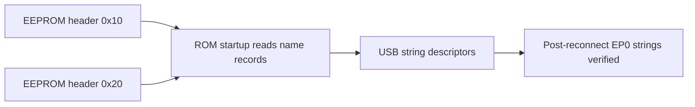

# MS2109 USB name header update

> Date: 8 October 2026  
> Target: attached MS2109, USB ID `534d:2109`  
> Analysis flavor: firmware reverse engineering (`flavor = null`)  
> Status: EEPROM updated and fully read back; post-reconnect USB name verification passed (see follow-up below)

## Summary

The qoaimei MS2109 firmware generator stores the video name in the EEPROM header record beginning at byte `0x10` and the audio name at `0x20`. Each 16-byte record starts with a byte for the total record length, including that prefix; the generator recomputes the header and code checksums after edits. I added matching `--video-name` and `--audio-name` support to this workspace's firmware builder and set both names to `MS2109-Pro`. The resulting image leaves all 1,816 firmware-code bytes unchanged from the installed image; only 22 name-record bytes and two header-checksum bytes changed. The user-authorized EEPROM write verified all 24 bytes and a complete image readback. At the time of this initial report, host-visible verification was pending; the later physical reconnect and passing string checks are recorded below.

## Scope and authorization

The target is the attached `534d:2109` dongle under the continuing MS2109 scope in [scope.md](scope.md). The user had already authorized RAM and EEPROM writes. The only persistent change in this update is the video/audio name records and their header checksum; the firmware code and code checksum match the prior installed image.

The EEPROM writer required the live image to exactly match the saved two-read backup before writing. It verified each changed byte, then saved and compared a complete readback. The prior image remains available at [installed-readback.bin](../artifacts/ms2109-repair/20261008/installed-readback.bin).

## Findings

### F-001 — The generator uses distinct video and audio header records

- severity: n/a_re
- category: reverse_algo
- status: validated for the generator and image format
- evidence_ids: E-001, E-002
- confidence: high for offsets and checksum handling
- location: `ms21xx_firmware/generate.py`, MS2109 branch; local `tools/build_patch.py:set_usb_names`

The upstream generator writes the video length and bytes at `0x10`/`0x11`, then the audio length and bytes at `0x20`/`0x21`. It computes the header checksum over bytes `0x02–0x2F` and separately recomputes the code checksum. It limits each name to 15 characters. The local builder now uses those offsets, writes the complete 16-byte fields with `0xFF` padding, and rejects non-ASCII or oversized names.

For `MS2109-Pro`, each new record is `0B` followed by the ten ASCII characters and five `FF` padding bytes. The length byte `0B` counts the one-byte prefix and the ten name bytes.

### F-002 — A live CBF0 edit does not rename audio string 4 in the running session

- severity: n/a_re
- category: reverse_algo
- status: validated for the tested running image
- evidence_ids: E-003
- confidence: high for the recorded before/after EP0 result
- location: XDATA `0xCBF0`, USB string descriptor 4

A reversible write changed the in-memory `CBF0` record from `usb video` to `MS2109-Pro`, but raw EP0 still returned `usb video`. The tool restored `CBF0` and its response buffer byte-for-byte, and two EEPROM reads matched the pre-probe hash. This probe did not test a cold boot with the new EEPROM header; the current evidence supports applying the header edit before startup rather than expecting a live source-table edit to rename the device.

### F-003 — Both EEPROM names are programmed; host-visible result is pending cold boot

- severity: n/a_re
- category: other
- status: candidate pending cold-boot validation
- evidence_ids: E-002, E-004
- confidence: high for EEPROM contents; not yet established for post-boot USB strings
- location: EEPROM header bytes `0x10–0x1F` and `0x20–0x2F`

The installed readback matches candidate SHA-256 `2c8e7378b6d23c324726b0fc641f9170af92692b00cf272fe59fda43c9f2fdc5`. The code section is byte-for-byte identical to the previously installed 1,816-byte overlay. The initial report stopped before cold-boot validation; the subsequent reconnect result is in F-004 and E-005 below.

### F-004 — Both live USB names match after physical reconnect

- severity: n/a_re
- category: other
- status: validated
- evidence_ids: E-005
- confidence: high for the live EEPROM readbacks and EP0 string responses
- location: USB string descriptors 2 and 4 after physical unplug/reconnect

The live EEPROM matched the named installed image on two reads. Header records at `0x10` and `0x20` decode as `MS2109-Pro`; live string descriptors 2 and 4 both returned that value. The read-only result is [nonfe-post-reconnect-usb-names-20261008.json](../artifacts/ms2109-repair/20261008/nonfe-post-reconnect-usb-names-20261008.json).

## Data path

The upstream generator edits these exact header fields and documents a disconnect/reconnect before checking the names. The post-reconnect device-side check passed, as recorded in E-005.

## Evidence

### E-001 — Upstream MS2109 name-generation code

- observed_at: 2026-10-08
- source_type: network
- source_ref: [qoaimei `generate.py`](https://github.com/qoaimei/ms21xx-firmware/blob/master/ms21xx_firmware/generate.py), MS2109 branch
- content_hash: n/a
- artifact_path: n/a
- repro_command: review `--video`/`--audio` handling and offsets `0x10`, `0x11`, `0x20`, `0x21`; review checksum updates after line 690
- raw_excerpt: The generator writes video length/data at offsets `0x10`/`0x11`, audio at `0x20`/`0x21`, then recomputes checksums.
- linked_workitem: n/a
- supersedes: none

The repository README also documents disconnecting and reconnecting the device before checking the Video Name and Audio Name fields: [qoaimei README](https://github.com/qoaimei/ms21xx-firmware).

### E-002 — Candidate bytes and offline validation

- observed_at: 2026-10-08
- source_type: file
- source_ref: [named candidate](../artifacts/ms2109-repair/20261008/ms2109-control-repair-named-candidate.bin) and [candidate metadata](../artifacts/ms2109-repair/20261008/ms2109-control-repair-named-candidate.json)
- content_hash: SHA-256 `2c8e7378b6d23c324726b0fc641f9170af92692b00cf272fe59fda43c9f2fdc5`
- artifact_path: `artifacts/ms2109-repair/20261008/ms2109-control-repair-named-candidate.bin`
- repro_command: `python3 tools/build_patch.py backups/ms2109-original.bin artifacts/ms2109-repair/20261008/ms2109-control-repair-named-candidate.bin --sharpness-profile --sharpness-edid rom --compact-sharpness --rom backups/ms2109-maskrom.bin --video-name MS2109-Pro --audio-name MS2109-Pro`
- raw_excerpt: Both 16-byte header records are `0b4d53323130392d50726fffffffffff`; code length is 1,816 and the existing code bytes match the installed image. The header checksum validates.
- linked_workitem: n/a
- supersedes: earlier runtime string-index/name-hook candidate

### E-003 — Reversible live audio-name source probe

- observed_at: 2026-10-08
- source_type: file
- source_ref: [RAM probe record](../artifacts/ms2109-repair/20261008/audio-name-source-ram-probe.json) and [recovery journal](../artifacts/ms2109-repair/20261008/audio-name-source-ram-probe.recovery.json)
- content_hash: SHA-256 `f150e99420c8f6ec1a56864aee505bc172b0a3e206e77660261e0bf9a01e99b3`
- artifact_path: `artifacts/ms2109-repair/20261008/audio-name-source-ram-probe.json`
- repro_command: `python3 tools/probe_uac_string_source_ram.py --output artifacts/ms2109-repair/20261008/audio-name-source-ram-probe.json --expected-eeprom artifacts/ms2109-repair/20261008/installed-readback.bin --name MS2109-Pro`
- raw_excerpt: EP0 string 4 was `usb video` before and during the RAM edit. Both RAM ranges were restored and verified. EEPROM SHA-256 stayed `bee6059bc398bda76348e4dfe7d3df76fbedd32ac8d5a0d79af97ab3ed382bab`.
- linked_workitem: n/a
- supersedes: none

### E-004 — EEPROM installation and full readback

- observed_at: 2026-10-08
- source_type: file
- source_ref: [installation record](../artifacts/ms2109-repair/20261008/usb-name-installation.json) and [installed readback](../artifacts/ms2109-repair/20261008/named-eeprom-installed-readback.bin)
- content_hash: SHA-256 `2c8e7378b6d23c324726b0fc641f9170af92692b00cf272fe59fda43c9f2fdc5`
- artifact_path: `artifacts/ms2109-repair/20261008/named-eeprom-installed-readback.bin`
- repro_command: `python3 tools/flash_eeprom.py --expected-current artifacts/ms2109-repair/20261008/installed-readback.bin --image artifacts/ms2109-repair/20261008/ms2109-control-repair-named-candidate.bin --apply --readback artifacts/ms2109-repair/20261008/named-eeprom-installed-readback.bin`
- raw_excerpt: 24 changed bytes were written and verified individually; the full 2,048-byte readback matches the candidate SHA-256.
- linked_workitem: n/a
- supersedes: prior installed image SHA-256 `bee6059bc398bda76348e4dfe7d3df76fbedd32ac8d5a0d79af97ab3ed382bab`

### E-005 — Read-only USB string verification after physical reconnect

- observed_at: 2026-10-08
- source_type: live_protocol_test
- source_ref: [post-reconnect USB name result](../artifacts/ms2109-repair/20261008/nonfe-post-reconnect-usb-names-20261008.json)
- content_hash: `b2094d39fc1b0f998491df25a88e27c4295827e622df1d354df6f28593ab3cdc`
- artifact_path: `artifacts/ms2109-repair/20261008/nonfe-post-reconnect-usb-names-20261008.json`
- repro_command: `python3 tools/qualify_usb_names.py --output artifacts/ms2109-repair/20261008/nonfe-post-reconnect-usb-names-20261008.json`
- raw_excerpt: Both complete EEPROM reads matched the installed SHA-256. Header names and USB string descriptors 2 and 4 all decode as `MS2109-Pro`.
- linked_workitem: non-FE live qualification
- supersedes: pending status in F-003 and the initial timeline

## Path

### P-001 — EEPROM name records to host-visible USB strings

- path_type: callflow
- start: EEPROM header records
- goal: USB reports `MS2109-Pro` for video and audio names
- steps:
  1. Encode each name in the fixed header record at `0x10` and `0x20`; validate the header checksum — evidence E-001 and E-002; finding F-001.
  2. Write the candidate only when the current EEPROM matches the saved image, then verify each changed byte and the complete readback — evidence E-004; finding F-003.
  3. Physically disconnect and reconnect the dongle, then read USB string descriptors 2 and 4 — passed; evidence E-005 and finding F-004.
- residual_risks: The running device did not reflect a CBF0 RAM edit. The installed header path is verified after reconnect; this does not identify every internal string-table source.

## Timeline

- 2026-10-08: inspected the upstream generator and README, added matching header-name support, and passed the targeted offline firmware tests.
- 2026-10-08: performed and restored the CBF0 RAM-only probe; the live EP0 result did not change and EEPROM remained unchanged.
- 2026-10-08: installed the header-only name update and verified a complete EEPROM readback; a later physical reconnect verified both host-visible names.

## Reproduction limits

The firmware image is raw 8051 code with a device-specific EEPROM wrapper, not PE/ELF; an executable import table is not applicable. Offline checks establish the record layout, checksum, and installed bytes. E-005 adds the live post-reconnect USB evidence for both strings.
