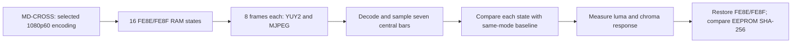

# MS2109 FE8E/FE8F color-patch probe

> Date: 2026-10-08  
> Target: attached MS2109 HDMI capture device  
> Report type: firmware/register behavior analysis (`flavor = null`)

## Executive summary

We tested every combination of FE8E and FE8F values `00`, `01`, `10`, and `11` while the Decimator MD-CROSS was set by the operator to 1080p60 RGB 4:4:4, YUV 4:2:2, and YUV 4:4:4. For each input condition, we captured eight frames per state in both YUY2 and MJPEG and compared seven central SMPTE bar patches against that condition’s baseline. Across all three selected input modes, FE8E bits 0/4 and FE8F bit 0 produced no measurable change in those patches; FE8F bit 4 produced a very small chroma gain of about 0.5%, with no measured luma change. The FE8F.4 result appears in both USB output formats and is not gated by the selected input encoding. The RGB-selected baseline differs from the YUV-selected baseline, while the seven measured YUV 4:2:2 and YUV 4:4:4 bar medians are identical. All three restore records confirm FE8E/FE8F restoration and an unchanged EEPROM hash; the records show zero EEPROM writes.

## Scope and method

The probe scope and authorization are recorded in [scope.md](../artifacts/ms2109-repair/20261008/scope.md). The probe was limited to RAM writes of FE8E and FE8F on the attached device. No firmware installation or EEPROM writes were performed. The operator selected each MD-CROSS input encoding; the MS2109 did not report the HDMI wire encoding, so those three conditions are user-reported. Each condition covered all 16 register pairs (4 values × 4 values), with eight frames in each USB format per pair. UVC brightness, contrast, hue, and saturation were set to their neutral values for the capture runs (0, 128, 0, 128).

The analyzer samples seven bars inside the central 75% of the chart. This excludes the gray side columns that were included by the first ROI draft. The per-mode analysis reports and contact sheets were regenerated from the saved captures with the corrected ROI. The RGB artifact directory retains `failure.txt` from an earlier offline decode attempt; that attempt failed before metrics were produced. The corrected offline replay completed and produced the `analysis.json`, `report.md`, and contact sheets linked here.

### Input-mode baseline measurements

The table reports median Y, Cb, and Cr codes for seven central patches at baseline FE8E=`00`, FE8F=`00`. MJPEG patch medians match the YUY2 values in each mode. The YUV 4:2:2 and YUV 4:4:4 medians match each other exactly at these seven patches.

| Patch | RGB 4:4:4: Y, Cb, Cr | YUV 4:2:2: Y, Cb, Cr | YUV 4:4:4: Y, Cb, Cr |
|---|---:|---:|---:|
| White | 191, 128, 128 | 180, 128, 128 | 180, 128, 128 |
| Yellow | 217, 5, 153 | 210, 16, 145 | 210, 16, 145 |
| Cyan | 164, 178, 10 | 169, 164, 16 | 169, 164, 16 |
| Green | 126, 56, 37 | 144, 53, 34 | 144, 53, 34 |
| Magenta | 128, 198, 217 | 106, 201, 220 | 106, 201, 220 |
| Red | 90, 77, 244 | 81, 90, 239 | 81, 90, 239 |
| Blue | 37, 250, 101 | 41, 239, 109 | 41, 239, 109 |

For YUV 4:2:2 minus RGB 4:4:4, per-channel RMSE across the seven patch medians is **Y 12.536, Cb 9.449, Cr 5.438 codes**; the per-channel median difference is **Y/Cb/Cr = -7.0, 0.0, 0.0 codes**. These are measured output differences for the selected source modes, not proof of the chip’s conversion matrix. Equal 4:2:2/4:4:4 patch medians do not establish that every pixel or HDMI transport sample was identical.

### Baseline images

These panels are cropped from the actual baseline cells (FE8E=`00`, FE8F=`00`) in the saved contact sheets. They compare the three operator-selected HDMI modes across the two USB output formats.

The combined image SHA-256 is `d6eac50520b58a97ced391ec4473f3cead534bfe7621dc56f0dc119a7e5cf25b`. Full 16-state sheets: [RGB YUY2](../artifacts/ms2109-repair/20261008/smpte-bars-rgb444-fe8e-fe8f-0-4-live/smpte-bars-yuy2-contact-sheet.png), [RGB MJPEG](../artifacts/ms2109-repair/20261008/smpte-bars-rgb444-fe8e-fe8f-0-4-live/smpte-bars-mjpeg-contact-sheet.png), [YUV 4:2:2 YUY2](../artifacts/ms2109-repair/20261008/smpte-bars-yuv422-fe8e-fe8f-0-4-live/smpte-bars-yuy2-contact-sheet.png), [YUV 4:2:2 MJPEG](../artifacts/ms2109-repair/20261008/smpte-bars-yuv422-fe8e-fe8f-0-4-live/smpte-bars-mjpeg-contact-sheet.png), [YUV 4:4:4 YUY2](../artifacts/ms2109-repair/20261008/smpte-bars-yuv444-fe8e-fe8f-0-4-live/smpte-bars-yuy2-contact-sheet.png), [YUV 4:4:4 MJPEG](../artifacts/ms2109-repair/20261008/smpte-bars-yuv444-fe8e-fe8f-0-4-live/smpte-bars-mjpeg-contact-sheet.png).

## Findings

### F-001 — FE8E bits 0/4 and FE8F bit 0 had no measured patch response

- severity: n/a_re
- category: reverse_algo
- status: validated
- evidence_ids: [E-001, E-002, E-003]
- location: MS2109 XDATA registers FE8E and FE8F
- impact: No visible change was measured in the seven sampled color patches at 1080p60 under the three selected input modes and two USB output formats. This does not rule out effects on geometry, other patterns, or other timings.
- confidence: high for the tested capture paths
- repro_steps: replay the three saved analyses and compare the 16 states with the per-mode baseline; the exact offline commands are listed under Evidence.
- remediation: n/a for pure register characterization.

### F-002 — FE8F bit 4 caused a small chroma-only gain

- severity: n/a_re
- category: reverse_algo
- status: validated
- evidence_ids: [E-001, E-002, E-003]
- location: FE8F bit 4
- impact: With FE8F=`10` or `11`, mean chroma-axis gain was **1.005151** for RGB 4:4:4 input and **1.005534** for either selected YUV input. Chroma RMS delta was **0.6547 code**; luma RMS delta was **0.0000 code**. The result was the same for YUY2 and MJPEG and independent of FE8E’s tested values.
- confidence: high for this pattern and these modes; low for semantic naming
- repro_steps: compare FE8F=`00`/`01` against `10`/`11` in each saved analysis file.
- remediation: do not label the bit as saturation or CSC control without broader evidence; the behavior is only consistent with a very small chroma gain.

### F-003 — Selected RGB and YUV input modes yielded different output baselines

- severity: n/a_re
- category: reverse_algo
- status: validated
- evidence_ids: [E-001, E-002, E-003]
- location: HDMI input processing path
- impact: RGB 4:4:4 versus YUV 4:2:2 selected modes differ across the seven measured output patch medians. The selected YUV 4:2:2 and YUV 4:4:4 modes have identical medians for those patches. This does not establish which exact conversion matrix or range the chip uses.
- confidence: high for patch medians; medium for generalizing beyond the pattern
- repro_steps: compare baseline `FE8E-00_FE8F-00` entries in the saved `analysis.json` files.
- remediation: none; use a calibrated full-range chart and verify HDMI link encoding independently before assigning matrix/range semantics.

### F-004 — RAM test state was restored; EEPROM did not change

- severity: n/a_re
- category: other
- status: validated
- evidence_ids: [E-004, E-005, E-006]
- location: FE80–FE8F state and EEPROM image
- impact: Each saved restore report shows FE8E/FE8F restored, zero EEPROM writes, and identical before/after EEPROM SHA-256 `2c8e7378b6d23c324726b0fc641f9170af92692b00cf272fe59fda43c9f2fdc5`.
- confidence: high for the values recorded in the three restore reports
- repro_steps: inspect each `restore-report.json` and confirm the before/after hashes and `fe8e_fe8f_restored` fields.
- remediation: n/a.

## Evidence

| ID | Evidence | Source and content hash | Reproduction |
|---|---|---|---|
| E-001 | Live-capture analysis, RGB 4:4:4 | `../artifacts/ms2109-repair/20261008/smpte-bars-rgb444-fe8e-fe8f-0-4-live/analysis.json` SHA-256 `d18da088843fc2e15865dcb3baa477fc0b3c3b83d30757b48f694507476e657a`; report: `../artifacts/ms2109-repair/20261008/smpte-bars-rgb444-fe8e-fe8f-0-4-live/report.md` | `python3 -B tools/probe_fe8e_fe8f_generator_bars.py --output artifacts/ms2109-repair/20261008/smpte-bars-rgb444-fe8e-fe8f-0-4-live --input-encoding rgb --analyze-existing` (offline replay; no device access) |
| E-002 | Live-capture analysis, YUV 4:2:2 | `../artifacts/ms2109-repair/20261008/smpte-bars-yuv422-fe8e-fe8f-0-4-live/analysis.json` SHA-256 `64aa70381200c8816439a8d408d5e27cdfca2b24e9b989858fb997d14cd5ec71`; report: `../artifacts/ms2109-repair/20261008/smpte-bars-yuv422-fe8e-fe8f-0-4-live/report.md` | `python3 -B tools/probe_fe8e_fe8f_generator_bars.py --output artifacts/ms2109-repair/20261008/smpte-bars-yuv422-fe8e-fe8f-0-4-live --input-encoding yuv422 --analyze-existing` (offline replay; no device access) |
| E-003 | Live-capture analysis, YUV 4:4:4 | `../artifacts/ms2109-repair/20261008/smpte-bars-yuv444-fe8e-fe8f-0-4-live/analysis.json` SHA-256 `8e8aa919238ab17d176479d49ac418b1e5415ac588d4ea1277ca78bee4ed9504`; report: `../artifacts/ms2109-repair/20261008/smpte-bars-yuv444-fe8e-fe8f-0-4-live/report.md` | `python3 -B tools/probe_fe8e_fe8f_generator_bars.py --output artifacts/ms2109-repair/20261008/smpte-bars-yuv444-fe8e-fe8f-0-4-live --input-encoding yuv444 --analyze-existing` (offline replay; no device access) |
| E-004 | Post-run restoration record, RGB 4:4:4 | `../artifacts/ms2109-repair/20261008/smpte-bars-rgb444-fe8e-fe8f-0-4-live/restore-report.json` SHA-256 `34095d3fc75c3d734a88ad8b2f06a162933eb2948efdde944904cfce3af00a36` | Captured by the live probe's restore phase; read this JSON directly |
| E-005 | Post-run restoration record, YUV 4:2:2 | `../artifacts/ms2109-repair/20261008/smpte-bars-yuv422-fe8e-fe8f-0-4-live/restore-report.json` SHA-256 `34095d3fc75c3d734a88ad8b2f06a162933eb2948efdde944904cfce3af00a36` | Captured by the live probe's restore phase; read this JSON directly |
| E-006 | Post-run restoration record, YUV 4:4:4 | `../artifacts/ms2109-repair/20261008/smpte-bars-yuv444-fe8e-fe8f-0-4-live/restore-report.json` SHA-256 `34095d3fc75c3d734a88ad8b2f06a162933eb2948efdde944904cfce3af00a36` | Captured by the live probe's restore phase; read this JSON directly |
| E-007 | Six-panel baseline comparison image | `../artifacts/ms2109-repair/20261008/smpte-bars-baseline-input-modes.png` SHA-256 `d6eac50520b58a97ced391ec4473f3cead534bfe7621dc56f0dc119a7e5cf25b` | Open the image; generated from the three saved baseline contact-sheet cells. |

The `restore-report.json` files independently record `fe8e_fe8f_restored: true`, `eeprom_writes: 0`, and matching EEPROM SHA-256 before/after. They do not preserve UVC-control readback fields; this report therefore does not use them as evidence for post-run UVC GET readback.

## Path

### P-001 — Live RAM register sweep and output comparison

- path_type: callflow
- start: Operator-selected MD-CROSS 1080p60 input mode
- goal: Measure FE8E/FE8F effects on captured color patches without persistent writes
- steps:
  1. Set one of the three source encodings and hold SMPTE HD bars — evidence: E-001, E-002, E-003 — finding: F-003
  2. Write each FE8E/FE8F pair to RAM and capture YUY2 and MJPEG — evidence: E-001, E-002, E-003 — finding: F-001, F-002
  3. Decode captures and compare central bar medians and luma/chroma deltas against the same-mode baseline — evidence: E-001, E-002, E-003 — finding: F-001, F-002, F-003
  4. Restore tested registers and compare EEPROM before/after hashes — evidence: E-004, E-005, E-006 — finding: F-004
- residual_risks: HDMI encoding was selected on the generator and not read from the link; no calibrated matrix/range reference was used; effects outside the seven patch regions and 1080p60 remain untested.

## Timeline summary

On 2026-10-08, the operator selected 1080p60 RGB 4:4:4, YUV 4:2:2, and YUV 4:4:4 in turn. Each condition received the same 16-state FE8E/FE8F sweep and YUY2/MJPEG capture procedure. The saved captures were reanalyzed with the corrected central-chart ROI, and all three restore records show no EEPROM change.

## Reproduction and limitations

For each input mode, run the matching offline command in the Evidence table. The `--analyze-existing` option reads saved capture files; it does not access or write the device. Re-running live capture requires the MS2109, MD-CROSS at the stated mode, and deliberate operator authorization for RAM writes. This probe does not establish meanings for FE8E/FE8F, distinguish a true CSC matrix from other input-path processing, or measure geometry/sharpness effects.
