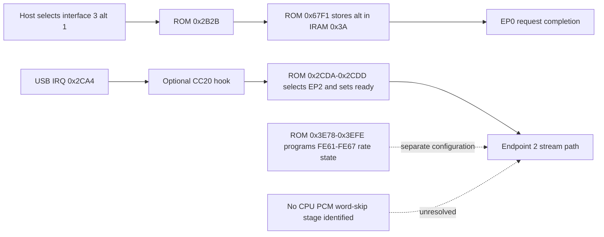

# MS2109 producer-side word-skip and serializer-phase control review

> Analysis date: 2026-10-06  
> Flavor: `null` (ordinary firmware reverse engineering)  
> Target: MS2109, USB VID:PID `534d:2109`  
> Method: read-only 8051 ROM and EEPROM-source review, plus previously saved capture evidence

## Executive summary

The reviewed ROM and published EEPROM source expose no CPU-side PCM copy loop, sample buffer pointer, or explicit word-skip control. The ROM records audio interface 3's alternate setting and later re-arms endpoint 2, but neither point identifies the first PCM word or a producer boundary. `FE60` changes source-channel routing in the tested configurations, and `FE61–FE67` are used in the ROM's rate-configuration path; neither has evidence of controlling sample-word alignment. A live `FE61` bit-0 toggle retained the one-sample lag. The producer-side skip and serializer phase control therefore remain unidentified; this conclusion is limited to the inspected firmware and does not rule out undocumented silicon controls.

## Scope and target

This work follows [the project scope](scope.html): the attached MS2109, its saved ROM/EEPROM images, RAM/ROM analysis, and the supplied audio-offset investigation are in scope. This pass performed offline firmware and evidence review only; it did not contact the dongle, change RAM, or write EEPROM.

The mask ROM is `backups/ms2109-maskrom.bin`, 52,224 bytes, SHA-256 `b383ef31fca43ebc58a22be8e342d9a1e33ec1cc15afce02921910b0ca358bc8`. The public source checkout is pinned at `70434570fdcf6dcf742919826ba98fd9f8614c5d`; the reviewed EEPROM assembly is `upstream/macrosilicon_firmware/ms2109/eeprom/crt0_ms2109.asm`, SHA-256 `9a90c6f23d1e80114ce1bd187867e24207845b0005e7f0808e48e769e7f2b962`. Radare2 6.2.2 was available; IDA Pro was not. The ROM is raw 8051 code with absolute-address calls, so address and register references were used instead of an import table.

## Control-point map

| Location | Observed role | Word-skip or phase value |
| --- | --- | --- |
| ROM `0x2B2B` → `0x67F1` | Handles `SET_INTERFACE`; for interface 3, copies the alternate-setting value into IRAM `0x3A` and marks EP0 completion pending. | A request/event point only. It does not access PCM or establish the first sample boundary. |
| ROM EP0 class dispatcher `0x2B34–0x2B8E` | Its inline class-request table maps UAC `SET_CUR` (`0x01`) through `0x2B64 → 0x6096 → 0x5EB4`, and `GET_CUR` (`0x81`) through `0x2B69 → 0x6A2C → 0x5FDE`. For `wIndex` low byte 2 and control selector 1, the getter returns `F1F8 & 1`; the setter commits the received byte from RAM staging `C020` to `F1F8`. Other interface-2 cases exchange values through EP0 and `C020–C021`. | This is a likely UAC AudioControl Feature Unit mute control (interface 2 is inferred from UAC 1.0 plus audio streaming interface 3). `F1F8` bit 0 behaves as a boolean mute value; it is not evidence of a word-skip or serializer-phase register. |
| Optional overlay `0xCC10` | Can intercept USB setup requests when `CBD4.1` is enabled. The calibrated image has flags `0x05`, so this hook is disabled; the address is used by the existing video callback. | Could observe the interface request, but no producer or sample control is present here. |
| ROM IRQ `0x2CA4–0x2CDF`, optional `0xCC20` | Snapshots USB IRQ state, calls the configured IRQ hook, then selects endpoint 2 and sets its ready bit at `0x2CDD` when the saved status gate passes. | A service/re-arm point, not a proven first-word or DMA boundary. The earlier reset experiment reached this general startup path but left the lag unchanged. |
| ROM vectors `0x000B`, `0x0013`, `0x0023` → optional `0xCC30`, `0xCC40`, `0xCC50` | `CBD4.3/.4/.5` gate Timer 0, external interrupt 1, and serial interrupt hooks, respectively. | Generic interrupt callbacks. No reviewed call path ties them to UAC samples or EP2 payload. In this EEPROM layout, `CC30–CC50` fall inside the inline `CC20` handler, so those flag bits must stay clear unless the overlay is deliberately rearranged. |
| ROM `0x61A1–0x61CB` | Initializes endpoint banks and USB control/status registers. It writes `A2:A3 = 00:01` and `CSR 0x90 = 0x70` for endpoint 2. | No source pointer or PCM transformation appears in this routine. The CSR interpretation is partly inferred. |
| `FE60` | Controlled values route the two source channels to the two captured USB channels. `01` corrected channel order; lag remained at −1. | Channel selection is supported by measurements. No evidence of word discard or serializer-lane reset. |
| ROM `0x3E78–0x3EFE`, `FE61–FE67` | Programs a rate-related audio register block. The `0x3EEC` branch sets `FE61` bit 0 on one rate path and clears bit 3; the other path sets bit 3. ROM helper `0x65CD` performs a masked read/modify/write. | Rate/configuration control, not a demonstrated sample-phase control. Toggling bit 0 did not correct the lag. Exact silicon semantics remain undocumented. |

The name `_regprog_phase` in the public EEPROM assembly is unrelated to serializer phase. It is the inner loop of the EEPROM IRQ register-programming helper, iterating table entries and computing target addresses.

There is an audio-related control handler in ROM, but it is not a callback on the PCM producer path. The interface-2 handler family implements the UAC `SET_CUR`/`GET_CUR` request pair for control selector 1. The getter masks `F1F8` to bit 0, and the setter commits its received value from `C020`; in UAC 1.0, Feature Unit selector 1 is Mute Control ([USB Audio 1.0 specification, A.9–A.10](https://www.usb.org/sites/default/files/audio10.pdf)). This is a strong mute-control match, not a timing control; the exact `F1F8` silicon meaning is still inferred. The wider class handler family also exchanges control values through `C020–C021`, which are in RAM-backed XDATA. Separately, `CC10` can intercept generic EP0 setup requests and `CC20` runs on the shared USB IRQ path before EP2 readiness is updated. Those hooks can observe control and endpoint events, but none receives PCM words or identifies the first audio sample. Interface 4's class handler is HID-like (`GET_REPORT`, `GET_IDLE`, `SET_REPORT`, `SET_IDLE`), not the audio handler. The other ROM callouts (`CC30/40/50`) are timer/external/serial interrupt hooks, not evidence of an audio sample callback.

## Findings

### F-201 — No producer-side word-skip point is exposed in the reviewed firmware

- Severity: `n/a_re`; category: firmware architecture.
- Status: candidate; confidence high for the inspected ROM paths and public EEPROM source, not for undocumented silicon behavior.
- Evidence: E-201, E-202.
- Location: ROM `0x61A1`, `0x67F1`, `0x2CA4–0x2CDF`; EEPROM overlay callbacks.
- Impact: firmware cannot safely discard exactly one PCM word using a source pointer or software packetizer that has been identified so far. The USB event hooks do not establish that samples are stopped or that the producer FIFO is empty.
- Reproduction: disassemble the listed ROM addresses and run `tools/audit_audio_usb_hooks.py` as shown under E-201 and E-202.
- Remediation: none established. A candidate must first identify the actual producer buffer/FIFO boundary or a documented producer-side skip bit.

### F-202 — `FE60` is a tested channel-routing control, not an alignment control

- Severity: `n/a_re`; category: firmware behavior.
- Status: candidate; confidence high for the tested source and settings.
- Evidence: E-203.
- Location: runtime XDATA register `FE60`.
- Impact: changing this register can fix which input channel appears on each captured output channel, but holding it at `01` does not remove the one-sample lag. A future phase change must still qualify channel labels jointly with alignment.
- Reproduction: analyze the saved startup capture; the historical controlled HDMI route tests are summarized in the linked report and preserved artifacts.

### F-203 — `FE61` rate gating does not provide the tested one-word correction

- Severity: `n/a_re`; category: firmware behavior.
- Status: validated for the tested toggle; confidence high for that experiment.
- Evidence: E-201, E-204.
- Location: ROM `0x3EEC` and runtime XDATA register `FE61` bit 0.
- Impact: ROM code conditionally configures rate-related state. The tested `09 → 08 → 09` bit-0 toggle did not move the correlation peak from −1 to zero, so this bit is not a useful alignment control on the measured path.
- Reproduction: inspect the preserved `audio-rate-gate` JSON and analyze its saved WAV offline. The live RAM-toggle experiment is not replayed by this report.

### F-204 — Audio control handling exists, but no producer-side sample callback is identified

- Severity: `n/a_re`; category: firmware architecture.
- Status: candidate; confidence high for the ROM dispatch map and current overlay layout.
- Evidence: E-202, E-205, E-206, E-207.
- Location: ROM `0x2B34–0x2B8E`, `0x4788`, `0x2CB3`, `0x5254–0x525B`, `0x560C–0x5613`, and `0x5813–0x581A`; overlay `0xCC10–0xCC50`.
- Impact: The ROM has an EP0 class-request route likely serving AudioControl interface 2, including a one-bit `F1F8` control, and `CC10`/`CC20` can observe generic setup and USB interrupt events. These are control/service points; the reviewed paths do not deliver PCM words or expose the first-word boundary. The Timer 0, external interrupt 1, and serial hooks are generic, and their current overlay entry addresses overlap the inline `CC20` handler.
- Reproduction: inspect the interface-2 getter/setter paths in E-207, the class dispatcher in E-206, and the ROM interrupt vectors and `CBD4` gates in E-205; compare overlay offsets with the current image header/code layout.
- Remediation: none established. Do not enable `CBD4.3/.4/.5` on the current image; consider those entries only after assigning safe callback trampolines and establishing a real audio timing relationship.

### P-201 — Audio startup call path and the remaining gap

- Path type: `callflow`.
- Start: host selects audio interface 3, alternate setting 1.
- Goal: align the first stereo PCM frame at the producer before endpoint 2 sends it.
- Steps:
  1. The ROM request switch dispatches `SET_INTERFACE` to `0x2B2B`; it calls `0x67F1`, which stores the alternate-setting value in IRAM `0x3A`. Evidence: E-201; Finding: F-201.
  2. The USB IRQ handler may call overlay `0xCC20`, then selects endpoint bank 2 and sets ready at `0x2CDD` when the saved IRQ gate allows it. Evidence: E-201, E-202; Finding: F-201.
  3. Endpoint 2 is initialized by `0x61A1`; the reviewed routines do not show a CPU sample copy, producer pointer advance, or first-word decision. The path into the PCM producer/serializer is therefore unresolved. Evidence: E-201; Finding: F-201.
- Residual risks: the silicon may expose undocumented serializer/FIFO controls not named or exercised by the available ROM/source. Endpoint CSR semantics remain partly inferred.

## Evidence

### E-201 — ROM setup, audio-rate configuration, and startup paths

- Observed: 2026-10-06.
- Source type: command and file.
- Source reference: `backups/ms2109-maskrom.bin`; `artifacts/rom-disassembly.txt`.
- Content hash: ROM SHA-256 `b383ef31fca43ebc58a22be8e342d9a1e33ec1cc15afce02921910b0ca358bc8`; saved disassembly SHA-256 `61ef16723286e6c9858d1ce6f7439f4831f75c839e813e797e8f793002e3d895`.
- Artifact path: `backups/ms2109-maskrom.bin`; `artifacts/rom-disassembly.txt`.
- Reproduction command: `r2 -q -a 8051 -b 8 -m 0x0000 -c 's 0x3e78; pd 80; s 0x65cd; pd 32; s 0x67f1; pd 12; s 0x2ca4; pd 25; s 0x61a1; pd 18' backups/ms2109-maskrom.bin`
- Raw excerpt: `0x67F1` copies IRAM `0x0E` to `0x3A` when the interface index is 3; `0x2CDD` sets endpoint-2 ready; `0x61A1` initializes endpoint registers; `0x3EEC` accesses `FE61`; `0x65CD` applies a mask and writes through `0x7011`.
- Linked work item: F-201, F-203, P-201.
- Supersedes: none.

### E-202 — Offline hook and endpoint byte audit

- Observed: 2026-10-06.
- Source type: command and file.
- Source reference: `tools/audit_audio_usb_hooks.py`, SHA-256 `18265882c56523a7381ec5ebabcfec27b3b610e4bf9baa944120987e2c93cc17`.
- Content hash: n/a (the script hash is recorded above; it independently verifies the ROM and calibrated EEPROM image hashes).
- Artifact path: `tools/audit_audio_usb_hooks.py`.
- Reproduction command: `python3 -B tools/audit_audio_usb_hooks.py`
- Raw excerpt: all 11 signatures passed, including `SET_INTERFACE → 0x67F1`, the optional `CC20` call before the ROM endpoint-2 ready write, and endpoint-2 setup at `0x61A1`. The audit reports that these hooks do not prove a sample-alignment fix.
- Linked work item: F-201, P-201.
- Supersedes: none.

### E-203 — Channel routing changes while the lag remains

- Observed: 2026-10-05/06.
- Source type: file and prior controlled capture.
- Source reference: `artifacts/channel-order-startup.wav`, SHA-256 `6367ad8bcadc57c0925b1a710a42bbfd352a437ad98795b4da44cef02a161ea4`; analysis `artifacts/channel-order-startup.analysis.json`, SHA-256 `b39a79c8467e1f241eb73558d1d61e1151638f78470e72ef61d7b732dbc495d7`; controlled settings summarized in `docs/2026-10-05_reverse-ms2109-report.md`.
- Content hash: as recorded above.
- Artifact path: the two files above.
- Reproduction command: `python3 -B tools/analyze_audio.py artifacts/channel-order-startup.wav --output /tmp/ms2109-channel-order-analysis.json`
- Raw excerpt: FE60 `01` routed the continuous left source to USB channel 0 and the gapped right source to channel 1; measured lag remained −1 (`0.97710` at −1 versus `0.96909` at zero). The historical value `10` reversed the channel order.
- Linked work item: F-202.
- Supersedes: none.

### E-204 — FE61 bit-0 toggle did not remove the offset

- Observed: 2026-10-05.
- Source type: file and prior RAM-only experiment.
- Source reference: `artifacts/audio-rate-gate.json`, SHA-256 `662e7d0eb4ad51b502294dd9a573ad56f5b492d1ba199dfbefbf17ad89240219`; analysis `artifacts/audio-rate-gate-analysis.json`, SHA-256 `49d2ca24ec0f76a4fd5a840a650323b0da6b1eabc5d4a61ef10de940477762c8`; WAV `artifacts/audio-rate-gate.wav`, SHA-256 `9251a47540a88ab0a946c4bc362d425328a0b8154fc5d1e27e66363092ef9268`.
- Content hash: as recorded above.
- Artifact path: the three files above.
- Reproduction command: `python3 -B tools/analyze_audio.py artifacts/audio-rate-gate.wav --output /tmp/ms2109-rate-gate-analysis.json` (offline analysis only; the original RAM toggle is not rerun).
- Raw excerpt: FE61 readback changed `09 → 08 → 09` and was restored. The saved capture's interchannel correlation peaked at −1 (`0.99614`) rather than zero (`0.98818`).
- Linked work item: F-203.
- Supersedes: none.

### E-205 — ROM has generic interrupt hooks in addition to USB hooks

- Observed: 2026-10-06.
- Source type: command and file.
- Source reference: `backups/ms2109-maskrom.bin`, SHA-256 `b383ef31fca43ebc58a22be8e342d9a1e33ec1cc15afce02921910b0ca358bc8`; calibrated EEPROM image `artifacts/ms2109-calibrated-stereo-channel-order.bin`, SHA-256 `83d13d9f31aee5301937adffbe8ed86c56ea5ec95a9880c4260cb7d25e1d5e82`.
- Content hash: as recorded above.
- Artifact path: the two files above.
- Reproduction command: `r2 -q -a 8051 -b 8 -m 0x0000 -c 's 0x0000; pd 12; s 0x5237; pd 20; s 0x55ef; pd 20; s 0x57f6; pd 20' backups/ms2109-maskrom.bin`
- Raw excerpt: standard vectors `0x000B`, `0x0013`, and `0x0023` jump to handlers that call `CC30`, `CC40`, and `CC50` when `CBD4.3`, `.4`, and `.5` are set. The calibrated image header flags are `0x05`, leaving these bits clear; its EEPROM code from `CC20` onward is the inline USB/video IRQ handler, so `CC30–CC50` are not independent entry stubs in this image.
- Linked work item: F-204.
- Supersedes: none.

### E-206 — ROM separates HID-like and audio-related class-control paths

- Observed: 2026-10-06.
- Source type: command and file.
- Source reference: `backups/ms2109-maskrom.bin`, SHA-256 `b383ef31fca43ebc58a22be8e342d9a1e33ec1cc15afce02921910b0ca358bc8`; upstream `eeprom/hw_defs.h` (SHA-256 `f3a04c9aca9f8ddfb10a66ddc3823a91c62cb73d2b0c59ac407473e25c998986`) identifies UAC 1.0 audio, and `rom/boot_annotated.md` describes XDATA `0xC000–0xDFFF` as RAM-backed, at pinned commit `70434570fdcf6dcf742919826ba98fd9f8614c5d`.
- Content hash: ROM hash as recorded above.
- Artifact path: the ROM and upstream source above.
- Reproduction command: `r2 -q -a 8051 -b 8 -m 0x0000 -c 's 0x2b34; pd 45; s 0x6672; pd 18; s 0x6ed7; pd 8; s 0x7003; pd 5; s 0x6a44; pd 16; s 0x6a5c; pd 16; s 0x6486; pd 18; s 0x64ac; pd 18; s 0x6632; pd 12' backups/ms2109-maskrom.bin`
- Raw excerpt: the class dispatcher sends `wIndex` low byte 4 to `0x6672`; that handler recognizes request IDs `01`, `02`, `09`, and `0A`, and its idle getter/setter reads/writes XDATA `C005`, which is HID-like behavior. The generic class table also has interface-2 branches to `0x6486`, `0x64AC`, and `0x6632`; these use EP0 transfer helpers, and `0x6486/0x64AC` exchange values with `C020–C021` in RAM-backed XDATA. Interface 2 is inferred to be AudioControl from the UAC 1.0 device description together with the separately confirmed audio streaming interface 3; the saved UVC color-descriptor JSON does not enumerate interface classes.
- Linked work item: F-204.
- Supersedes: none.

### E-207 — Interface-2 class controls include a one-bit hardware control

- Observed: 2026-10-06.
- Source type: command and file.
- Source reference: `backups/ms2109-maskrom.bin`, SHA-256 `b383ef31fca43ebc58a22be8e342d9a1e33ec1cc15afce02921910b0ca358bc8`; upstream `eeprom/hw_defs.h` identifies UAC 1.0 audio at pinned commit `70434570fdcf6dcf742919826ba98fd9f8614c5d`; [USB Audio 1.0 specification](https://www.usb.org/sites/default/files/audio10.pdf), Appendix A.9–A.10.
- Content hash: ROM hash as recorded above.
- Artifact path: the ROM and upstream source above.
- Reproduction command: `r2 -q -a 8051 -b 8 -m 0x0000 -c 's 0x2b48; px 0x20; s 0x2b64; pd 6; s 0x2b69; pd 6; s 0x6096; pd 16; s 0x6a2c; pd 12; s 0x5fde; pd 16; s 0x5eb4; pd 24' backups/ms2109-maskrom.bin`
- Raw excerpt: class table entries pair `SET_CUR` (`01`) with `0x2B64` and `GET_CUR` (`81`) with `0x2B69`. The `0x2B64` case calls `0x6096`, whose `wIndex` low-byte 2 branch reaches `0x5EB4`; this SET path receives one byte into RAM `C020` and writes it to XDATA `F1F8` when `wValue` high byte is 1. The `0x2B69` case calls `0x6A2C`, whose interface-2 branch reaches `0x5FDE`; this GET path reads `F1F8`, masks bit 0, and returns it through EP0 when `wValue` high byte is 1. UAC 1.0 defines Feature Unit selector 1 as Mute Control, so the mapping strongly matches a mute bit. No path accesses sample indexing or serializer phase.
- Linked work item: F-204.
- Supersedes: none.

## Timeline summary

- 2026-10-05: raw USB packet capture established the −1-sample lag before CoreAudio framing; channel-route tests corrected channel labels but not lag.
- 2026-10-05: a RAM-only `FE61` bit-0 toggle retained the −1 peak and restored the original register value.
- 2026-10-06: the corrected event trace and wideband startup-reset test still did not identify the first PCM word or change the lag. Details remain in [the sample-offset report](2026-10-06_sample-offset-ms2109-report.html) and [firmware-options reassessment](2026-10-06_sample-offset-firmware-options.html).

## Remaining question

No named control for producer-side word skip or serializer lane phase was found in the reviewed public firmware. The next useful investigation is a read-only before/after register comparison around interface-3 alternate-setting transitions, followed by a raw endpoint capture using a known wideband reference. That would distinguish a startup-only hardware register from an event hook without repeating the rejected endpoint reset or `FE61` rate-bit candidate. No persistent patch is justified until such a control has direct evidence and the resulting raw and native captures pass the alignment and channel-label checks.
