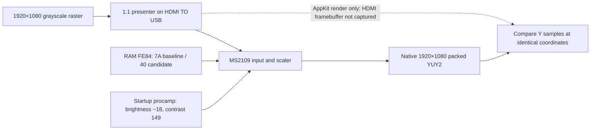

# MS2109 native luma response and FE84 control report

> Date: 7 October 2026<br>
> Target: attached MS2109 capture device, USB ID `534d:2109`<br>
> Analysis: native 1920×1080 YUY2 Y-plane comparison; RAM-only FE84/procamp tests

## Summary

The default native-1080 setting `FE84=7A` adds strong frequency-dependent luma contrast relative to the saved chart render. A reversible RAM-only `FE84=40` test removed that measured frequency dependence: 32-, 16-, 8-, 4-, and 2-pixel gray stripes matched the presenter’s AppKit source-render Y samples at their original coordinates under the device’s existing startup procamp (brightness −18, contrast 149). The full-frame comparison also matched that render within one code outside a tiny top-right capture-only overlay. These are comparisons against an AppKit render, not a measured HDMI framebuffer, so they do not by themselves establish end-to-end input-to-capture pixel identity. Qualified 1280×720 tests show that FE84 changes scaled detail while preserving sampled flat-field Y. Selected values spanning `0x00–0xFF` all read back and captured valid charts, with a smooth response around `0x7F/0x80`; the high bit is active, although spatial-frequency response is not a simple monotonic sharpness scale. No EEPROM was written; mode selection and the UVC request path remain unimplemented.

## Scope and authorization

This work used only the user’s attached MS2109, the user-controlled HDMI chart, and its USB capture path. The user requested a solution for exact native-size luma and had authorized reversible RAM register testing in this ongoing MS2109 investigation. No other device, host, or network was in scope. See the project [scope record](scope.html).

The experiment changed RAM `FE84` and the brightness/contrast hardware registers and matching UVC shadows temporarily. It restored those values and checked the EEPROM image hash before and after. No EEPROM or flash bytes were written.

## Measurement method

The presenter showed a 1920×1080 grayscale chart at 1:1 on the verified `HDMI TO USB` display. The reference is the presenter’s AppKit `source-render.png`, which records its render before late compositor/display overlays; ScreenCaptureKit did not provide a screenshot of the actual HDMI/compositor framebuffer. Capture saved packed YUY2 bytes through AVFoundation; analysis read each Y sample directly and did not convert captured frames to RGB.

The acceptance regions contain only neutral gray pixels, so BT.601 and BT.709 RGB-to-Y weights yield the same expected luma there. The full-raster comparison uses BT.709 luma from the source-render as a diagnostic reference. Scaled capture sizes are not used for this native-identity result.



## Findings

### F-001 — FE84=40 removes the measured native-frequency boost

- severity: n/a_re
- category: reverse_algo
- status: validated
- evidence_ids: [E-001, E-002, E-003]
- location: XDATA `FE84`; ROM mode-setup writer `6FA3–6FA9`
- impact: the default `FE84=7A` does not preserve the saved AppKit chart render’s luma response. `FE84=40` produced render-aligned Y in all five tested gray-stripe periods while retaining the current procamp profile. This does not independently measure the source pixels that reached HDMI.
- confidence: high for this attached unit, chart, and 1920×1080 mode; medium for register semantics
- remediation: evaluate a mode-specific `FE84=40` setup only after validating other output sizes. Do not treat `FE84` as a decoded sharpness gain or write it persistently based on this single mode.

| FE84 | Startup procamp | 32px contrast | 16px | 8px | 4px | 2px | Captured Y in each stripe ROI |
|---:|---|---:|---:|---:|---:|---:|---|
| `7A` | −18 / 149 | 0.347458 | 0.367452 | 0.404057 | 0.478261 | 0.598746 | Varies with pattern period |
| `40` | −18 / 149 | 0.329513 | 0.329513 | 0.329513 | 0.329513 | 0.329513 | `232 / 117` at every period |

The source-render stripe levels are `232 / 117` at every period. At `FE84=40`, each captured stripe sample matched that source-render luma at the same pixel coordinate (zero displacement, zero code error in these ROIs). The source-render Michelson contrast is also 0.329513.

### F-002 — Neutral procamp is not sufficient by itself

- severity: n/a_re
- category: other
- status: validated
- evidence_ids: [E-002, E-003]
- location: hardware procamp `FE90–FE91` and shadows `C6A0–C6A3`
- impact: temporary brightness 0 / contrast 128 reduced the large contrast gain but left native high-frequency boost at `FE84=7A` (2px contrast 0.564 versus 32px 0.316). The useful correction in this test came from FE84, with the existing startup procamp restored.
- confidence: high for the tested register/control state
- remediation: preserve the existing startup procamp while evaluating FE84. Do not attribute the native ringing solely to brightness/contrast calibration.

### F-003 — Whole-frame native Y is within one code of the AppKit render

- severity: n/a_re
- category: other
- status: validated
- evidence_ids: [E-001, E-002]
- location: full 1920×1080 captured Y plane
- impact: the `FE84=40` current-procamp capture had mean absolute Y error 0.332 codes against BT.709 luma from the AppKit source-render. In each of eight frames, 99.99749% of all pixels were within one code. The 52 pixels with larger residuals lie in an 8×8 area at x=1908–1915, y=4–11, where captured content is absent from the cached AppKit render. Outside the conservative top-right 20×12 overlay area, all pixels in every frame were within one code. Because the source screenshot was unavailable, this finding describes agreement with the saved AppKit render only.
- confidence: high for the recorded AppKit-render/capture pair; it does not establish direct HDMI pixel identity, and the late overlay’s exact origin is unconfirmed
- remediation: exclude the top-right overlay from strict chart scoring, or move the chart’s scored region away from that area.

## Evidence

### E-001 — Native chart render and display state

- observed_at: 2026-10-07
- source_type: file
- source_ref: `artifacts/scaler-f9a0/chart-session-20261007-001220-51789/`
- content_hash: `source-render.png` SHA-256 `46006d710cab7c1dd7b941a12bb2e1db9e73b48c64486956b7dcbcc8757ecc1b`
- artifact_path: `artifacts/scaler-f9a0/chart-session-20261007-001220-51789/source-render.png`
- repro_command: `python3 tools/show_scaler_chart.py --image artifacts/scaler-f9a0/test-chart-1920x1080.png --output artifacts/scaler-f9a0/chart-session-rerun --render-space native --seconds 3600`
- raw_excerpt: readiness metadata confirms 1920×1080, `chart_kind=full-frame-raster`, `window_screen=HDMI TO USB`, and a matching display profile; no ScreenCaptureKit screenshot of the HDMI/compositor framebuffer was available.
- linked_workitem: n/a
- supersedes: none

### E-002 — Raw Y capture and FE84 sweep

- observed_at: 2026-10-07
- source_type: file
- source_ref: `artifacts/scaler-f9a0/native-luma-identity-fe84-current-20261007/result.json`
- content_hash: result JSON SHA-256 `75cfa42f3f1377209c4a215d7eef4df0a4f36656bf248316155ea699d775bdaf`; FE84=40 raw payload SHA-256 `c6fc7c67d22a614348b9bc85f97d40fd2e6fb29b93ec8c6882b9d277b57c0965`
- artifact_path: `artifacts/scaler-f9a0/native-luma-identity-fe84-current-20261007/`
- repro_command: `python3 tools/probe_native_luma_identity.py --output artifacts/scaler-f9a0/native-luma-identity-rerun --fe84-current-values 40 --fe84-values`
- raw_excerpt: at FE84=40, all five native stripe regions have Y `232/117` and zero code error against the source-render luma; in all eight frames, every pixel outside the top-right overlay region is within one code.
- linked_workitem: n/a
- supersedes: none

### E-003 — Register restore and EEPROM integrity

- observed_at: 2026-10-07
- source_type: file
- source_ref: `artifacts/scaler-f9a0/native-luma-identity-fe84-current-20261007/result.json`
- content_hash: n/a; the read-only pre/post EEPROM hash is recorded in E-002
- artifact_path: `artifacts/scaler-f9a0/native-luma-identity-fe84-current-20261007/result.json`
- repro_command: included in E-002; the script reads back RAM values and computes two full EEPROM hashes
- raw_excerpt: final FE84=`7A`; FE90–FE93=`EE 95 93 00`; C6A0–C6A7=`EE FF 95 00 00 00 93 00`; EEPROM unchanged.
- linked_workitem: n/a
- supersedes: none

## Path

### P-001 — Native 1080 luma comparison and reversible scaler adjustment

- path_type: solve
- start: a chart displayed at native 1920×1080
- goal: find a RAM-only FE84 value that matches the saved AppKit render's luma across spatial frequencies and pixel coordinates
- steps:
  1. Confirm the full-frame chart and display profile — evidence: E-001 — finding: none
  2. Capture packed YUY2 and read Y directly with FE84=7A — evidence: E-002 — finding: F-001
  3. Test FE84 candidates and compare same-coordinate Y against the AppKit source-render — evidence: E-002 — finding: F-001
  4. Restore FE84/procamp shadows, read them back, and compare EEPROM hashes — evidence: E-003 — finding: none
- residual_risks: FE84 arithmetic is not decoded; other input/output dimensions remain untested; no actual HDMI/compositor framebuffer reference was available, and the AppKit render excludes late overlays.

## Timeline

- 6 October: earlier 720p captures showed a bidirectional FE84 effect on fine-stripe contrast; no EEPROM change.
- 7 October: user specified that 1080-in to 1080-capture must be judged pixel-to-pixel in Y; scaled sizes were excluded from this acceptance gate.
- 7 October: native raw Y confirmed strong frequency-dependent contrast at FE84=7A. Current RAM procamp was brightness −18 / contrast 149.
- 7 October: temporary FE84=40 matched all five source-render stripe periods. FE84 and procamp were restored; EEPROM hash stayed unchanged.

## Reproduction and limits

The current chart must remain full-screen on the target display. Run the guarded capture with a new output directory:

```sh
python3 tools/probe_native_luma_identity.py \
  --output artifacts/scaler-f9a0/native-luma-identity-rerun \
  --fe84-current-values 40 --fe84-values 40 60 74 7a 80
```

The helper requires the expected EEPROM image and startup procamp state. It captures eight frames per state, uses raw YUY2, restores every RAM/shadow value even if a capture fails, and rejects any EEPROM hash change. It writes no EEPROM or flash bytes.

The remaining decision is whether to patch mode setup so native 1920×1080 uses FE84=40 and scaled modes retain a separately qualified value. The ROM currently writes a fixed `0x7A` in a shared initialization path, and a mode discriminator has not been identified. Before treating `0x40` as an end-to-end pixel-perfect setting, compare raw capture against a directly observed HDMI raster or trusted hardware pattern generator. No persistent image change is included.

## Follow-up: scaled-mode qualification and ROM setup trace

### F-004 — FE84 mode selection is in common initialization; no mode gate is established

- severity: n/a_re
- category: reverse_algo
- status: observed
- evidence_ids: [E-004]
- location: ROM `0x3F0B`, `0x3F84`, `0x6F3F`, `0x6FA3–0x6FA9`
- impact: the ROM setup path reaches a fixed `FE84=7A` write. Static references found two call sites for the containing initialization routine, at `0x31D7` and `0x5375`; both callers can reach the same fixed write. No exact input/output-dimension branch around this write has been established, so a safe native-only patch condition is still unknown.
- confidence: high for the disassembly and direct references; low for the undocumented meaning of caller states
- remediation: identify a reliable mode/timing discriminator and validate it live before changing the ROM image.

### E-004 — Static call path; attempted scaled capture rejected as invalid

- observed_at: 2026-10-07
- source_type: file
- source_ref: `backups/ms2109-maskrom.bin` and `tools/probe_fe84_scaled_y.py`
- content_hash: n/a
- artifact_path: `artifacts/scaler-f9a0/fe84-scaled-y-10fps-rois-20261007/`
- repro_command: `r2 -q -a 8051 -b 8 -m 0 -c 'aaa; axt @ 0x6f3f; axt @ 0x3f0b; s 0x3f03; pd 100' backups/ms2109-maskrom.bin`
- raw_excerpt: `0x3F84` calls `0x6F3F`; `0x6F3F` loads `R7=7A` and jumps to `0x6FA3`; `0x6FA3–0x6FA9` writes R7 to `FE84`. References to the routine containing this path are at `0x31D7` and `0x5375`.
- linked_workitem: n/a
- supersedes: none

The first attempted 1280×720 RAM comparison is **not valid visual evidence**. Its result directory contains a raw capture of the Mac desktop, not the scaler chart; the old chart readiness JSON had gone stale. FE84 was restored to `7A`, and the EEPROM hash remained unchanged. The subsequent display-launch failures came from running the presenter without macOS host display/camera permissions, not from an absent monitor: a host-permission read-only listing confirmed the “HDMI TO USB” 1920×1080 display and MS2109 capture device. `tools/probe_fe84_scaled_y.py` now checks that the captured image matches the chart and that interior flat fields remain pixel-constant before and after writing FE84.

### F-005 — FE84=40 reduces fine-chart contrast at 1280×720 while preserving flat-field Y

- severity: n/a_re
- category: reverse_algo
- status: validated
- evidence_ids: [E-005, E-006]
- location: live XDATA `FE84`; scaled 1280×720 YUY2 output
- impact: `0x40` changes spatial response in the scaled path: Michelson contrast falls from 0.305755 to 0.294371 for 32-source-pixel stripes, 0.269474 to 0.251617 at 16px, 0.238845 to 0.198274 at 8px, and 0.102375 to 0.074728 at 4px. The 2px source patch aliases to near-flat gray at both values. Sampled black, white and gray fields remain exactly Y=16, 232 and 117, with no within-field or frame variation and no change between register settings.
- confidence: high for the recorded chart and device/output mode; medium for whether the lower contrast is closer to the mathematically ideal scaled reference
- remediation: do not apply `0x40` globally based only on the native-size result. A host slider could expose the register, but its range and label need qualification because FE84 is not decoded as a sharpness gain.

### E-005 — Chart-gated raw 720p capture and restore

- observed_at: 2026-10-07
- source_type: file
- source_ref: `artifacts/scaler-f9a0/fe84-scaled-y-qualified-20261007/result.json`
- content_hash: baseline YUY2 SHA-256 `dd20fb4252ef583cc732922d688cb77eb818a3ffe02412b6f238d818db9f2b5a`; candidate SHA-256 `3d244c91627e020e28a20364e161642ef0a54af1fb2a3a333729a8a4ab789d3a`
- artifact_path: `artifacts/scaler-f9a0/fe84-scaled-y-qualified-20261007/`
- repro_command: `python3 tools/probe_fe84_scaled_y.py --chart-session artifacts/scaler-f9a0/chart-session-scaled-20261007d --output artifacts/scaler-f9a0/fe84-scaled-y-qualified-20261007`
- raw_excerpt: 8 raw YUY2 frames per setting; chart correlation 0.935 (`0x7A`) and 0.949 (`0x40`); mean absolute Y delta 2.062606 codes; 14.5887% of samples changed. Black/white/gray field levels were exactly `[16]`, `[232]`, `[117]` for both settings.
- linked_workitem: F-005
- supersedes: the invalid scaled comparison described above

### E-006 — Derived stripe response

- observed_at: 2026-10-07
- source_type: file
- source_ref: `artifacts/scaler-f9a0/fe84-scaled-y-qualified-20261007/analysis.json`
- content_hash: FE84=7A / FE84=40 raw YUY2 hashes are recorded in the analysis file
- artifact_path: `artifacts/scaler-f9a0/fe84-scaled-y-qualified-20261007/analysis.json`
- repro_command: `python3 tools/analyze_fe84_scaled_y.py artifacts/scaler-f9a0/fe84-scaled-y-qualified-20261007`
- raw_excerpt: stripe contrasts and flat-field Y levels are calculated directly from packed YUY2 luma; captured Y is not converted to RGB for scoring.
- linked_workitem: F-005
- supersedes: none

After the test, FE84 read back as `7A`; the EEPROM SHA-256 remained `83d13d9f31aee5301937adffbe8ed86c56ea5ec95a9880c4260cb7d25e1d5e82`. The host-permission chart presenter confirmed the target display remained `HDMI TO USB` at 1920×1080. `FE84=40` is a measured native-1080 correction candidate that also softens high-frequency detail in the 720p path without disturbing sampled flat levels. This supports mode-dependent behavior, but does not establish a safe ROM mode discriminator or a mode-independent UVC fader curve.

### F-006 — FE84 provides a near-monotonic detail response across the sampled 720p band

- severity: n/a_re
- category: reverse_algo
- status: validated
- evidence_ids: [E-005, E-007]
- location: XDATA `FE84`; 1280×720 YUY2 output
- impact: across 19 sampled values from `0x40` to `0x80`, 32/16/8/4-pixel stripe contrast rose by 4.2%/7.5%/22.2%/43.6%. The only local reversals were 0.000176 at 16 pixels (`7A→7B`) and 0.000181 at 8 pixels (`7B→7C`). The 2-pixel pattern remained near flat because it aliases at this output size. Black, white and gray field Y stayed exactly 16/232/117.
- confidence: high for this device, chart, sampled values and 1280×720 capture; medium for interpolated values and register semantics
- repro_steps:
  1. Show the 1920×1080 chart on `HDMI TO USB` and preserve the fresh readiness record.
  2. Run `tools/probe_fe84_range_scaled_y.py` with that chart session; it captures three raw YUY2 frames per value, verifies chart correlation and flat fields, then restores FE84.
- remediation: selected values across the full byte range can back an 8-bit UVC mapping, but first implement and qualify the UVC descriptor/request path and test more output modes. Do not persist a global value based on this 720p curve.

### E-007 — Chart-gated FE84 range sweep and RAM restore

- observed_at: 2026-10-07
- source_type: file
- source_ref: `artifacts/scaler-f9a0/fe84-range-scaled-y-20261007/result.json`
- content_hash: SHA-256 `2f6acb7781984b9ff565b4d23a2cb64334216d1f8a003056109bd590fd33d9ec`
- artifact_path: `artifacts/scaler-f9a0/fe84-range-scaled-y-20261007/`
- repro_command: |
    python3 tools/show_scaler_chart.py --output artifacts/scaler-f9a0/chart-session-fe84-range-20261007 --seconds 3600
    python3 tools/probe_fe84_range_scaled_y.py --output artifacts/scaler-f9a0/fe84-range-scaled-y-20261007 --chart-session artifacts/scaler-f9a0/chart-session-fe84-range-20261007
- raw_excerpt: 19 FE84 values × 3 frames; minimum chart correlation 0.933538; flat fields were constant at Y=16/232/117 for every value. FE84 restored to 7A; FE80/FE85/F9A0/F92C/FEBA matched the pre-test values; EEPROM SHA-256 stayed 83d13d9f31aee5301937adffbe8ed86c56ea5ec95a9880c4260cb7d25e1d5e82.
- linked_workitem: F-006
- supersedes: none

### E-008 — ROM UVC request dispatcher and Processing Unit descriptor state

- observed_at: 2026-10-07
- source_type: file
- source_ref: `backups/ms2109-maskrom.bin`
- content_hash: disassembly transcript SHA-256 `37146628ca8f14c9fb724878388a28af55e429e0ea915451f3d264e7b7206483`; input ROM SHA-256 `b383ef31fca43ebc58a22be8e342d9a1e33ec1cc15afce02921910b0ca358bc8`
- artifact_path: `artifacts/programmer-reference/uvc-sharpness-dispatch.txt`
- repro_command: `r2 -q -a 8051 -b 8 -m 0 -c 's 0x2ad0; pd 110; s 0x3d45; pd 55; s 0x6a2c; pd 20; s 0x6096; pd 40; s 0x4788; pd 12; px 16 @ 0x714a; px 16 @ 0x7605; px 16 @ 0xc073' backups/ms2109-maskrom.bin`
- raw_excerpt: ROM `0x4788–0x4797` selects EEPROM hook `CC10` only when `CBD4.1` is set, otherwise it calls built-in dispatcher `0x2AD0`. The installed image keeps the bit clear, and the existing `CC10` bytes serve a video-table callback. One ROM path recognizes UVC GET request codes `0x81–0x84`, but does not establish support for Sharpness selector `0x08` or all required queries. The Processing Unit records at `0x714A`, `0x7605` and XDATA `0xC073` each show `bmControls=0x000F`; no Sharpness bit is advertised. Descriptor override and a complete selector-`0x08` path have not been established.
- linked_workitem: P-002
- supersedes: none

### F-007 — FE84 is an active 8-bit control path across the byte endpoints

- severity: n/a_re
- category: reverse_algo
- status: validated
- evidence_ids: [E-009]
- location: XDATA `FE84`; selected values in 1280×720 YUY2 mode
- impact: 26 distinct values sampled from `0x00` through `0xFF` read back exactly and produced chart-valid captures. `0x7F`, `0x80`, and `0x81` had distinct, smoothly changing stripe responses, so bit 7 is active and the control is not limited to seven value bits. Eight-pixel contrast changed from 0.145443 at `0x00` to 0.333640 at `0xFF`; four-pixel contrast peaked near `0xB0` and then eased to 0.134502 at `0xFF`. Flat-field Y remained exactly 16/232/117.
- confidence: high for byte storage, endpoint acceptance, active bit 7, and measured response at sampled values; unresolved for uniqueness/linearity of all 256 codes and semantic coefficient meaning
- remediation: a host control may map a 16-bit UVC value to the FE84 byte, but its range and curve should be mode-aware and must not be presented as a calibrated sharpness gain without further validation.

### E-009 — FE84 lower and upper byte-range probes

- observed_at: 2026-10-07
- source_type: file
- source_ref: `artifacts/scaler-f9a0/fe84-range-low-20261007/result.json` and `artifacts/scaler-f9a0/fe84-range-high-20261007/result.json`
- content_hash: lower JSON SHA-256 `3c0a5d197833fd2f959150d98be3046a0ae9120da0516f277b1605487af9ddac`; upper JSON SHA-256 `761d690d75078347dd3a0297e0a71cfd61e0dc6ef058e77c614a652d17bfe288`
- artifact_path: `artifacts/scaler-f9a0/fe84-range-low-20261007/` and `artifacts/scaler-f9a0/fe84-range-high-20261007/`
- repro_command: |
    python3 tools/probe_fe84_range_scaled_y.py --output artifacts/scaler-f9a0/fe84-range-low-20261007 --chart-session artifacts/scaler-f9a0/chart-session-fe84-extended-20261007 --values 7A 60 50 40 3F 30 20 10 08 04 02 01 00
    python3 tools/probe_fe84_range_scaled_y.py --output artifacts/scaler-f9a0/fe84-range-high-20261007 --chart-session artifacts/scaler-f9a0/chart-session-fe84-extended-20261007 --values 7A 7F 80 81 82 88 90 A0 B0 C0 D0 E0 F0 FF
- raw_excerpt: 13 values in the lower pass and 14 in the upper pass, three frames each; chart correlation ranged 0.909452–0.957335; flat fields stayed at Y=16/232/117; all values read back; both runs restored FE84=`7A`; FE80/FE85/F9A0/F92C/FEBA returned to their initial bytes; EEPROM SHA-256 remained `83d13d9f31aee5301937adffbe8ed86c56ea5ec95a9880c4260cb7d25e1d5e82`.
- linked_workitem: P-002
- supersedes: none

### P-002 — UVC request to FE84 fader feasibility path

- title: Expose FE84 as a host Processing Unit fader
- path_type: callflow
- start: Host enumerates VideoControl Processing Unit and sends a class request
- goal: A standard host slider updates RAM `FE84` and reads its current/range values
- steps:
  1. The Processing Unit bitmap currently advertises `0x000F`, so standard Sharpness is hidden — evidence: E-008 — finding: none.
  2. ROM selects the built-in request dispatcher at `0x2AD0`, or the EEPROM hook at `CC10` when `CBD4.1` is set — evidence: E-008 — finding: none.
  3. A candidate custom handler would need to multiplex the existing CC10 video-table call, delegate unrelated requests, implement Sharpness selector `0x08` query/set replies, and map the 16-bit host range to FE84's byte values — evidence: E-005, E-007, E-008, E-009 — finding: F-006, F-007.
  4. Descriptor advertisement, SET_CUR behavior, host-visible controls and behavior in other capture modes remain to be implemented and verified — evidence: E-008, E-009 — finding: F-007.
- residual_risks: The descriptor is ROM-owned at several copies; the route for safely altering it has not been proved. FE84 is a probable scale/filter parameter, not a decoded sharpness gain, and its spatial-frequency response is non-monotonic in this tested scaled mode.
